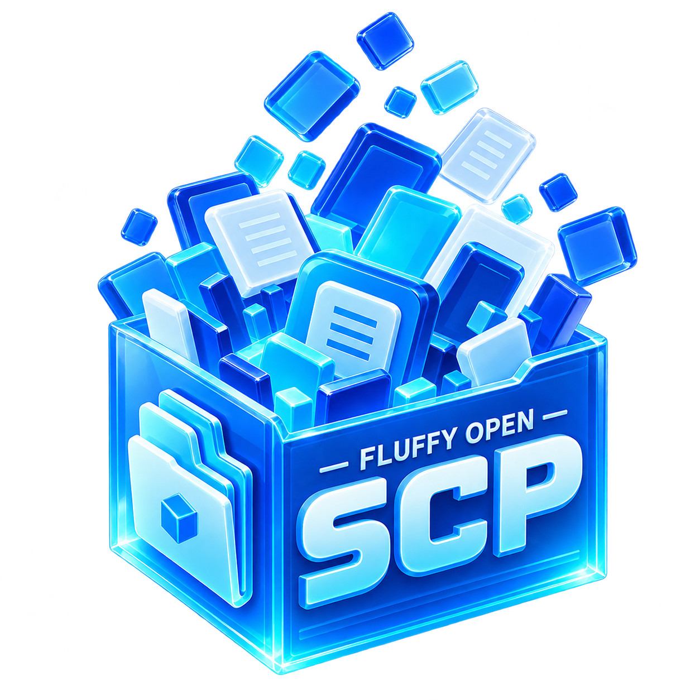
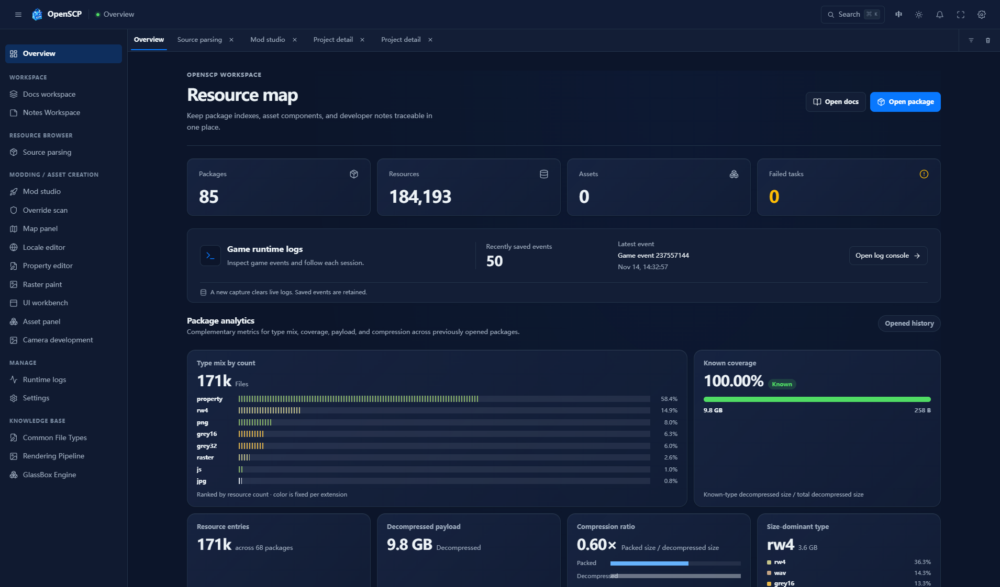
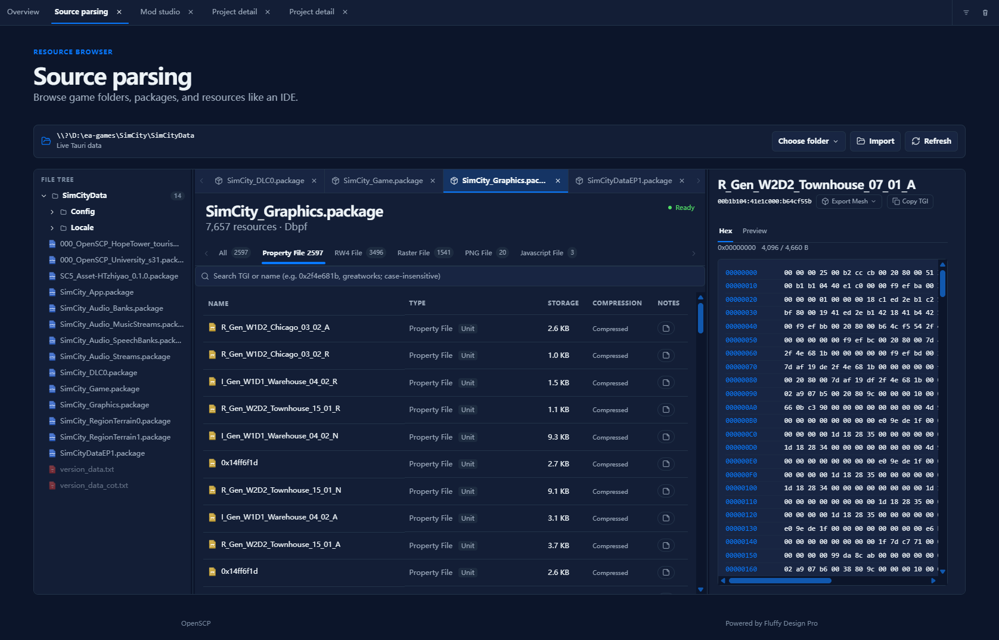
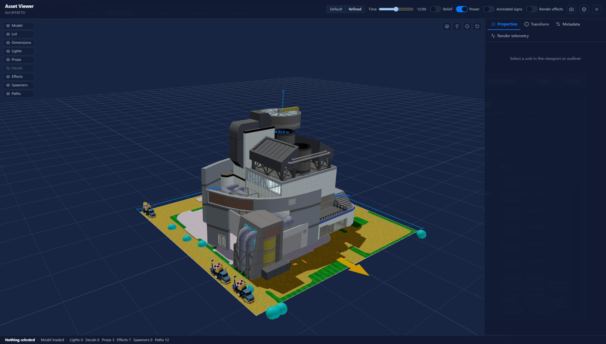
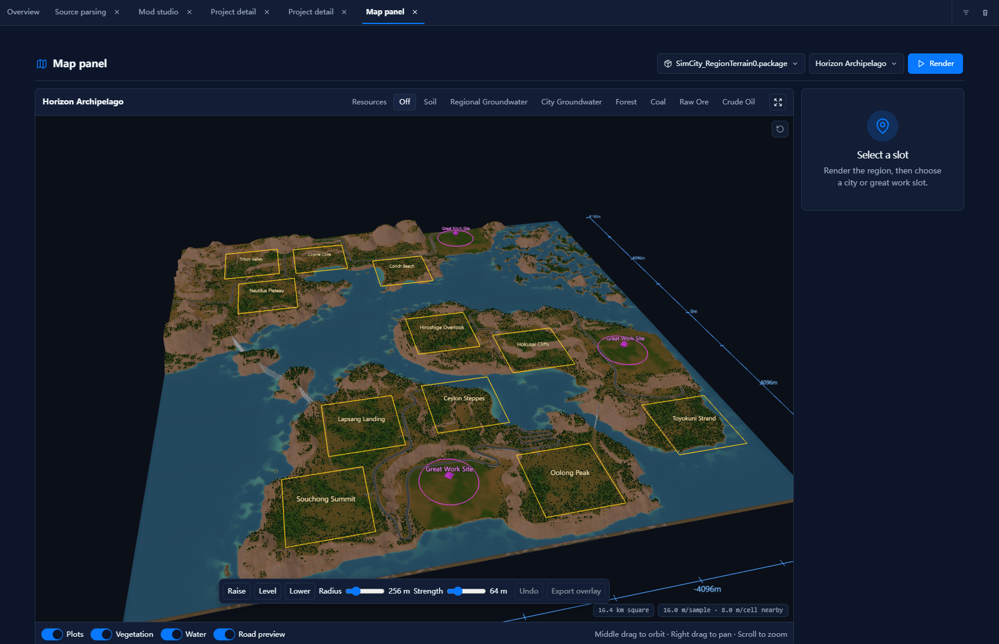
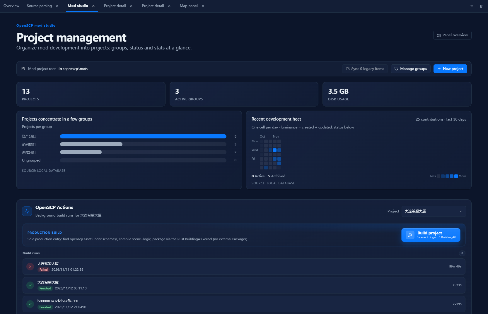
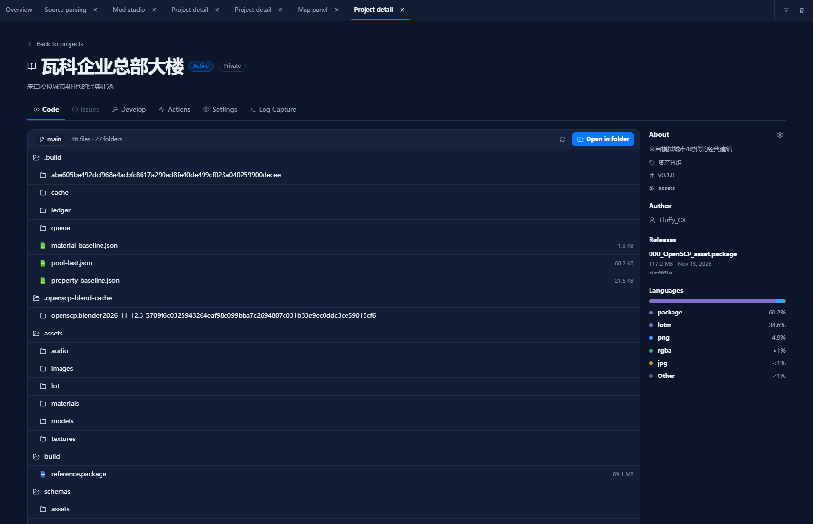
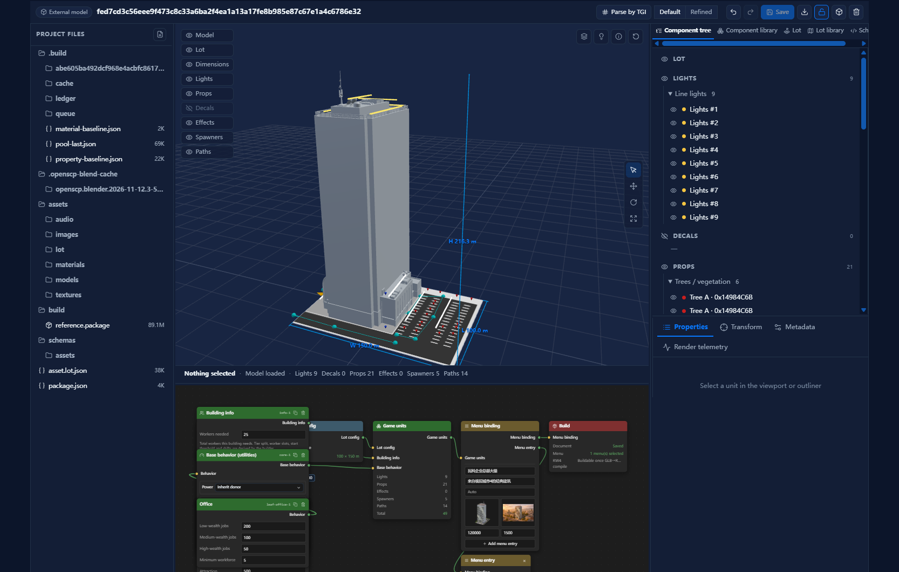

<p align="center">
  
</p>

[中文](README.md) | **English**

# OpenSCP

OpenSCP is a SimCity (2013) desktop resource browser and modding workbench built with Rust, Tauri 2, and Vue 3. It continues the resource browsing workflow of [SimCityPak](https://github.com/altinctrl/SimCityPak) and adds 3D asset previews, scene editing, and building mod packaging.

**Current version 0.12.0**. This update includes scene-driven building builds, project detail and build history, terrain brushes with overlay export, and game runtime logs with asset diagnostics.

## Screenshots

### Resource map

Review resource types, decompressed sizes, compression ratios, and recognized-type coverage across opened packages, and jump to the runtime log console.



### Source parsing

Browse DBPF packages in a file tree and tabs. Filter by type, search by name or TGI, and open a hex view or a resource preview.



### Asset Viewer

Inspect the building model, lot, and dimensions in 3D. Toggle lights, props, decals, and paths, and adjust the time of day and power state.



### Map panel

Inspect regional terrain, resource layers, city plots, and Great Work sites. Use terrain brushes to raise, level, or lower the surface and export an overlay package.



### Mod Studio

Create and group mod projects, review recent activity, and start or track background builds in OpenSCP Actions.



### Project detail

Browse source files and build artifacts, and open the Develop, Actions, Settings, or Log Capture views for a project.



### Scene workbench

Arrange building and lot components in 3D, then configure building behavior and menu entries in the node graph. The Rust Building40 builder reads `openscp.asset` under `schemas/` and generates a `.package`.



## Usage

1. Download a Windows installer (MSI or NSIS) from the project releases page, or build from source using the commands below.
2. In **Settings → Game directory**, choose the installation folder containing `SimCityData`, or open a `.package` directly from Source parsing.
3. Find resources by TGI (Type / Group / Instance) and preview models, textures, property lists, or media. Export models as glTF (`.glb`) or OBJ and property lists as JSON or TXT.
4. Create a mod project in Mod Studio, open its Develop view, and use **OpenSCP Actions → Build project** to generate a package and inspect the result.

The workbench also includes TGI override scanning, locale and property editing, [Raster paint](docs/assets/publicity/raster-paint.png), and game UI previews.

### ⚠️ Audio/Video Transcoding Requires Manual External Tools

Audio (Wwise → WAV) and video (VP6 → MP4) preview/export **depend on two external tools that installers do not bundle**:

| Tool | Purpose | Install (either way) |
|---|---|---|
| **vgmstream** | Wwise Vorbis audio → WAV | `winget install --id vgmstream.vgmstream -e --source winget`; or download from [GitHub Releases](https://github.com/vgmstream/vgmstream); or place it in the app folder `Tools\vgmstream\` |
| **ffmpeg** | VP6 video → MP4 | `winget install --id Gyan.FFmpeg -e --source winget`; or download from [ffmpeg.org](https://ffmpeg.org); or place it in the app folder `Tools\ffmpeg\` |

Without them, audio/video previews show the tool name and install command; everything else keeps working. Lookup order: app folder `Tools\` → system `PATH`.

## Project Layout

```
fluffy-open-scp/
├── src/                    # Vue 3 frontend (fluffy-design-pro app shell)
├── src-tauri/              # Tauri 2 app shell (command binding layer)
├── crates/
│   ├── dbpf/               # DBPF (.package) container format + RefPack decompression
│   ├── rw4/                # RenderWare4 model / texture / skeleton / animation parsing
│   ├── sc-properties/      # Property list resource (0x00b1b104) parsing
│   ├── sc-registry/        # Read-only access to the database_main.s3db descriptor DB
│   ├── sc-store/           # App activity/history persistence (SQLite)
│   └── sc-exporter/        # OBJ / glTF / texture / property-list exporters
└── docs/
    ├── overview/           # Domain knowledge: rendering pipeline, file formats
    ├── rendering.md        # Renderer source research (shader reverse engineering)
    └── roadmap/            # Migration & Modding Suite planning
```

## Further reading

- [Rust format migration](docs/roadmap/migration.md)
- [Map workbench roadmap](docs/roadmap/map-workbench.md)
- [GlassBox engine notes](docs/overview/glass-box/README.md)
- [Rendering pipeline research](docs/rendering.md)

## Development

Prerequisites: Rust (stable, edition 2024), Node.js ≥ 20, pnpm ≥ 11, plus the usual Tauri 2 Windows prerequisites (WebView2, MSVC Build Tools).

```bash
pnpm install          # install frontend dependencies
pnpm tauri dev        # desktop app in dev mode
pnpm tauri build      # production build
pnpm test             # frontend tests (vitest)
cargo test            # Rust tests (workspace)
```

Browser demo mode: open the Vite dev server outside Tauri, run
`localStorage.setItem("openscp:local-key", '{"version":1,"mode":"mock"}')` in the console and refresh to explore the full UI with synthetic data.

## Credits

- [altinctrl/SimCityPak](https://github.com/altinctrl/SimCityPak) — the origin of this migration (originally a CodePlex project; all original rights belong to their authors)
- [vgmstream](https://github.com/vgmstream/vgmstream) / [ffmpeg](https://ffmpeg.org) — audio/video decoding
- [fluffy-design-pro](https://github.com/FluffyChi-Xing/fluffy-design-pro) — UI app shell and component ecosystem

## License

MIT. All original rights related to SimCity and SimCityPak belong to their respective authors.
