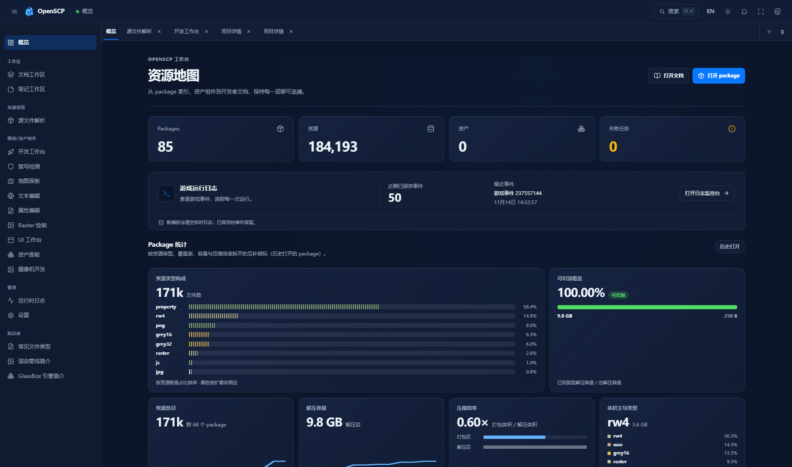
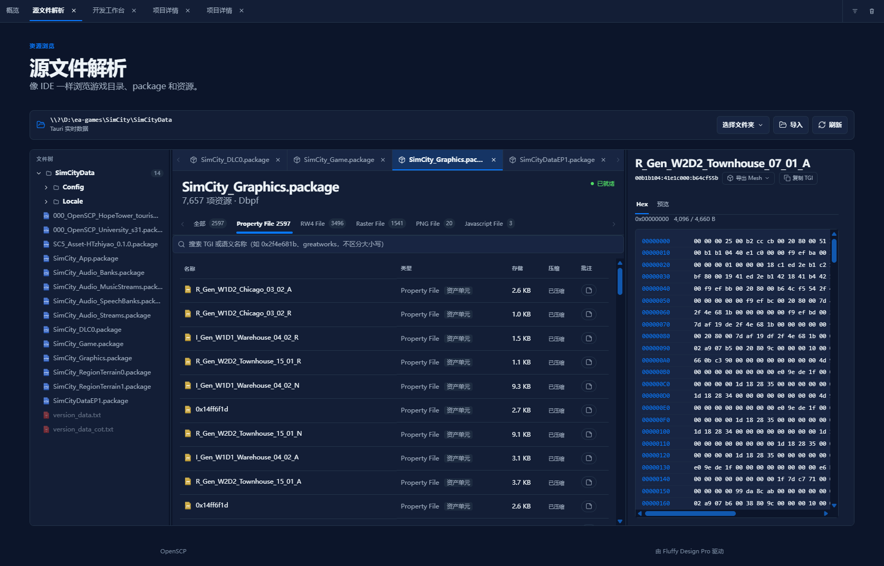
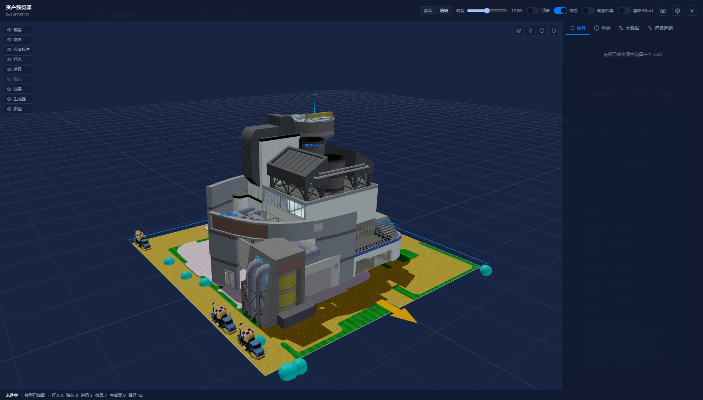
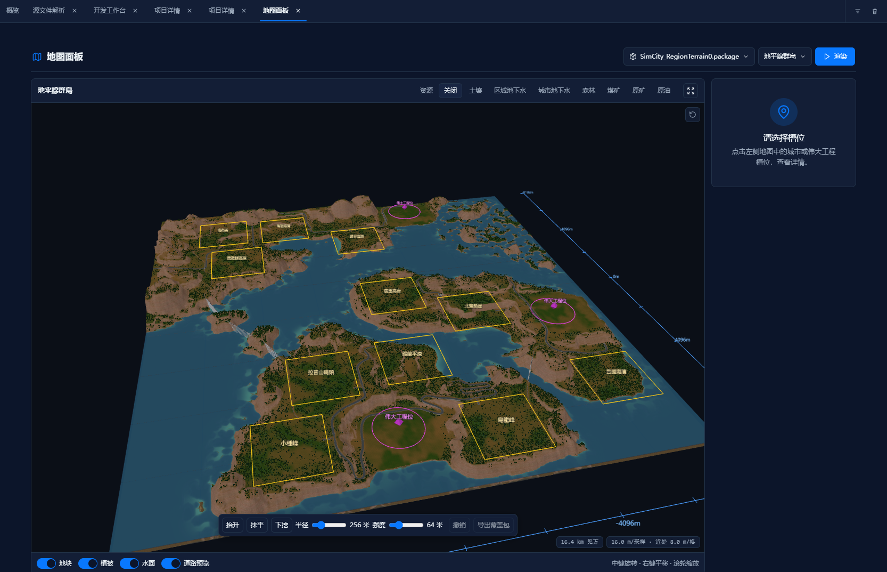
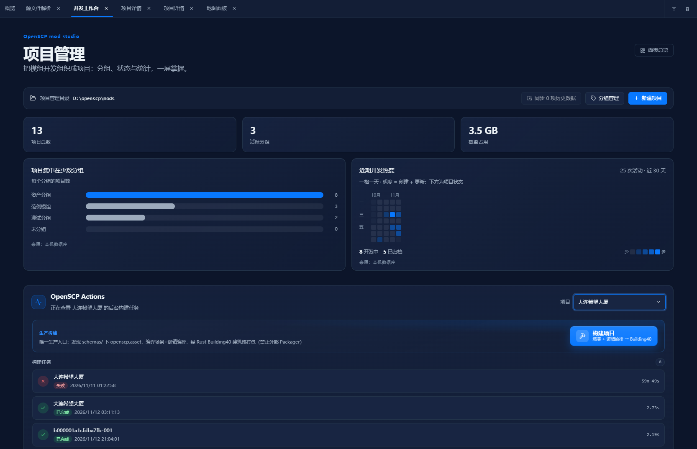
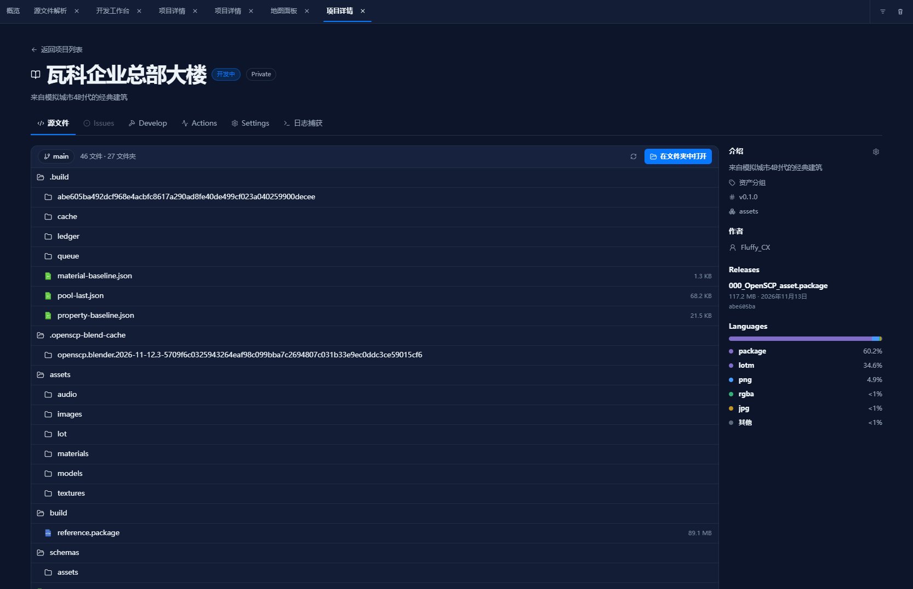
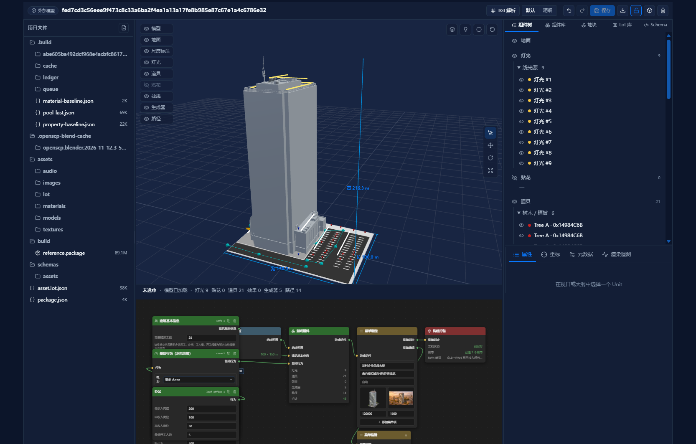

<p align="center">
  
</p>

**中文** | [English](README.en.md)

# OpenSCP

OpenSCP 是面向 SimCity (2013) 的桌面资源浏览器和模组工作台，基于 Rust、Tauri 2 和 Vue 3。项目延续了 [SimCityPak](https://github.com/altinctrl/SimCityPak) 的资源浏览工作流，并加入 3D 资产预览、场景编辑和建筑模组构建。

**当前版本 0.12.0**。本次更新包括场景驱动的建筑打包、项目详情和构建记录、地形笔刷与覆盖包导出，以及游戏运行日志和资产诊断。

## 界面预览

### 资源地图

显示已打开 package 的资源类型分布、解压容量、压缩率和识别覆盖率，并提供游戏运行日志入口。



### 源文件解析

通过目录树和多标签页浏览 DBPF package，按类型筛选、按名称或 TGI 搜索，并查看十六进制数据或资源预览。



### 资产预览器

在 3D 视口中查看建筑模型、地块和尺寸，切换灯光、道具、贴花与路径图层，调整时段和供电状态。



### 地图面板

查看区域地形、资源图层、城市地块与伟大工程槽位。用笔刷抬升、抹平或下挖地形，并导出覆盖包。



### 开发工作台

创建和分组管理模组项目，查看近期活动，在 OpenSCP Actions 中启动后台构建并跟踪结果。



### 项目详情

在项目内查看源文件和构建产物，打开开发视图、构建记录、设置和日志捕获。



### 场景构建工作台

在 3D 场景中布置建筑和地块组件，在节点图中配置建筑行为与菜单项。构建时读取 `schemas/` 下的 `openscp.asset`，通过 Rust Building40 构建器生成 `.package`。



## 使用方法

1. 从项目发布页下载 Windows 安装包（MSI 或 NSIS），或按下方开发说明从源码构建。
2. 在 **设置 → 游戏目录** 选择含有 `SimCityData` 的安装目录，也可以在「源文件解析」中直接打开 `.package`。
3. 按 TGI（Type / Group / Instance）定位资源，预览模型、贴图、属性表或媒体。模型可导出为 glTF（`.glb`）或 OBJ，属性表可导出为 JSON 或 TXT。
4. 在「开发工作台」创建模组项目，从项目详情进入开发视图，再通过 **OpenSCP Actions → 构建项目** 生成包并查看结果。

工作台还提供 TGI 复写检测、Locale 文本编辑、属性编辑、[Raster 绘制](docs/assets/publicity/raster-paint.png)和游戏 UI 预览。

### ⚠️ 音视频转码需要手动安装外部工具

音频（Wwise → WAV）和视频（VP6 → MP4）预览/导出**依赖两个外部工具，安装包不会自动附带**：

| 工具 | 用途 | 安装方式（任选其一） |
|---|---|---|
| **vgmstream** | Wwise Vorbis 音频 → WAV | `winget install --id vgmstream.vgmstream -e --source winget`；或从 [GitHub Releases](https://github.com/vgmstream/vgmstream) 下载解压；也可放入应用目录 `Tools\vgmstream\` |
| **ffmpeg** | VP6 视频 → MP4 | `winget install --id Gyan.FFmpeg -e --source winget`；或从 [ffmpeg.org](https://ffmpeg.org) 下载；也可放入应用目录 `Tools\ffmpeg\` |

未安装时音频/视频预览会显示工具名与安装命令提示，其余功能不受影响。查找顺序：应用目录 `Tools\` → 系统 `PATH`。

## 项目结构 / Project Layout

```
fluffy-open-scp/
├── src/                    # Vue 3 前端（fluffy-design-pro 应用壳）
├── src-tauri/              # Tauri 2 应用壳（command 绑定层）
├── crates/
│   ├── dbpf/               # DBPF (.package) 容器格式 + RefPack 解压
│   ├── rw4/                # RenderWare4 模型 / 贴图 / 骨骼 / 动画解析
│   ├── sc-properties/      # 属性列表资源 (0x00b1b104) 解析
│   ├── sc-registry/        # database_main.s3db 描述符库只读访问
│   ├── sc-store/           # 应用活动/历史持久化 (SQLite)
│   └── sc-exporter/        # OBJ / glTF / 贴图 / 属性表导出器
└── docs/
    ├── overview/           # 领域知识：渲染管线、文件格式
    ├── rendering.md        # 渲染器源码调研（shader 逆向）
    └── roadmap/            # 迁移与 Modding Suite 规划
```

## 进一步阅读

- [Rust 格式迁移进度](docs/roadmap/migration.md)
- [地图工作台规划](docs/roadmap/map-workbench.md)
- [GlassBox 引擎笔记](docs/overview/glass-box/README.md)
- [渲染管线调研](docs/rendering.md)

## 开发 / Development

环境要求：Rust（stable，edition 2024）、Node.js ≥ 20、pnpm ≥ 11，以及 Tauri 2 在 Windows 下的常规依赖（WebView2、MSVC Build Tools）。

```bash
pnpm install          # 安装前端依赖
pnpm tauri dev        # 桌面应用开发模式
pnpm tauri build      # 构建发布版
pnpm test             # 前端测试（vitest）
cargo test            # Rust 测试（workspace）
```

浏览器 demo 模式：非 Tauri 环境下访问 vite dev server，在控制台执行
`localStorage.setItem("openscp:local-key", '{"version":1,"mode":"mock"}')` 后刷新，可用合成数据预览全部 UI。

## 致谢 / Credits

- [altinctrl/SimCityPak](https://github.com/altinctrl/SimCityPak) —— 本项目迁移来源（原 CodePlex 项目，原始权利归原作者所有）
- [vgmstream](https://github.com/vgmstream/vgmstream) / [ffmpeg](https://ffmpeg.org) —— 音视频解码
- [fluffy-design-pro](https://github.com/FluffyChi-Xing/fluffy-design-pro) —— UI 应用壳与组件生态

## License

MIT。SimCity 与 SimCityPak 相关的原始权利归其各自作者所有。
