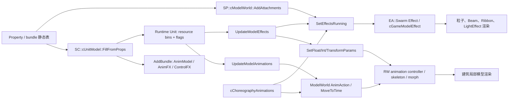

# 建筑局部动画与运行时视觉投影复刻设计报告

日期：2026-10-27  
对象：SimCity 2013 建筑、工厂、消防站等包含传送带、货物、风扇、卷帘门、煤炭消耗和局部灯光的 Property  资产  
目标：让 OpenSCP Property Editor 在不牺牲首屏性能的前提下，逐步达到“静态资产 + 可复现运行时状态 + 所见即所得动画”的开发体验

## 1. 结论

游戏并不需要把建筑导出成许多可见的面片，才能驱动局部运动。局部动画至少有三条独立路径：

1. **模型动画路径**：RW4 模型的 skeleton、`rw::oldanimation::KeyframeAnimation`、controller 和 animation group 驱动节点/骨骼、蒙皮或 morph。传送带、风扇、卷帘门等可以属于这一类。
2. **模型参数路径**：`SC::cUnitModel::UpdateModelEffects` 根据资源 bin 的 `amount / capacity` 把比例插值为时间、浮点、整数或 Transform 参数，再写入 ModelWorld。货物位置、煤炭余量、风扇速度或模型效果可以属于这一类。
3. **Swarm Effect / choreography 路径**：Effect attachment 由 `EA::Swarm` 解算粒子/光/模型效果；choreography 按轨道时间启停动画和 Effect。火焰、烟雾、消防水柱，以及“下班后卷帘门落下”这种事件序列可以走此路径。

因此，从 GLB 中看不到可拆分面片，只能说明当前导出物没有把运行时动画绑定完整地呈现出来，不能说明原游戏没有动画。OpenSCP 目前的缺口是确定的：`read_lot_model_meshes` 在生成 LOTM 时调用 `export_glb_with_colors(&mesh, None, &[], ...)`，明确丢弃了 RW4 skeleton 和 ANIM；前端 `AssetModelPreview.vue` 也只取 `gltf.scene`，没有创建 `AnimationMixer`。这会把“有动画资源的模型”降级为静态 mesh。

## 2. 引擎实际的装配与更新顺序



`FillFromProps` 先建立图形对象和 choreography，再调用 `AddBundle` 解析动画表。`AddBundle` 把 Property 中的资源 ID 转成运行时 resource-bin 索引；如果资源 bin 不存在，该动画项会被丢弃。这解释了为什么同一个模型在不同 Unit/扩建状态下可以拥有不同的实际动画输入。

## 3. 已核实的源码证据

### 3.1 模型动画不是面片拆分

`SP::cModelWorld::AnimAction` 遍历最多六个 `cModelInstanceAnimations`，调用 `SetActive(id, animGroup, active, blendTime, oneShot)`。`GetAnimationRange` 通过 `cModelInstanceAnimations::GetAnimationRange` 查找指定 animation ID 在指定 group 中的最大时长。`MoveToTime` 则把时间写进 skeleton、skin 和 morph 的 `cMultiBlender`。

`cModelInstanceAnimations::Animate` 每帧推进：

- `mSkeletonBindings`：骨骼/节点输出；
- `mSkinBindings`：蒙皮 controller；
- `mMorphBindings`：morph controller。

这些绑定在 `rw::oldanimation::KeyframeAnimation` 上运行。一个 mesh 可以保持一个整体，动画通过节点变换、蒙皮权重或 morph 改变顶点最终位置。导出后如果只看静态 POSITION/index，就会误以为“没有可动部件”。

### 3.2 `cGameModelEffect` 会创建并驱动模型动画

`SP::cGameModelEffect::Start`：

- 根据 `mAnimationCurves` 数量决定模型创建模式；
- `CreateModel` 创建 `cMWModel`；
- `EA::Swarm::SetupAnimationInfo` 初始化曲线状态；
- 必要时创建 split controller；
- 把模型加入 ModelWorld。

`ApplyEffect` 每帧调用 `EA::Swarm::ApplyAnimationInfo`，随后按每条 curve 的 `mChannelID` 查 `GetAnimationRange`，把曲线值插值成时间并调用 `ModelWorld::MoveToTime`。这是一条“Effect 曲线 → 模型 animation channel”的路径，和普通粒子不是同一个渲染器。

`SetFloatParams` 支持 alpha、颜色、LOD 参数，以及按 animation index 覆盖 age；`SetIntParams` 支持整数状态。也就是说模型效果既可以由时间曲线驱动，也可以由运行时参数改变。

### 3.3 `AddBundle` 暴露了可复刻的动画表结构

以下 Property 表 ID 已由 `SC::cUnitModel::AddBundle` 直接读出：

| 表 | 关键字段 | 运行时含义 |
|---|---|---|
| AnimModel | `166979251` bin、`166979252` anim ID、`166979253` speed、`166979254/255` value1/value2 | 资源比例驱动模型 animation channel 的相对时间 |
| AnimFXFloat | `166979267` bin、`166979268` effect/anim ID、`166979272` param ID、`166979269` speed、`166979270/271` value1/value2 | 资源比例驱动 float/int 模型或 Effect 参数 |
| AnimFXVector3 | `166979283` bin、`166979284` effect/anim ID、`166979288` param ID、`166979285` speed、`166979286/287` Vector3 范围 | 资源比例驱动向量/Transform 参数 |
| AnimFXActive | `166979299` bin、`166979300` effect ID、`166979302/303` 开启阈值 | 资源比例跨阈值启停 Effect |
| ControlFXActive | `166979312` flag bit、`166979313` effect ID | control flag 置位时启停 Effect |

字段名称仍需和真实 Property schema 做一轮 TGI 对照，但表的列数、读法和目标函数已经闭合，足以作为 OpenSCP 的静态绑定模型。

### 3.4 资源 bin 如何驱动模型动画

`SC::cUnitModel::UpdateModelAnimations` 的核心算法是：

```text
ratio = clamp(amount / capacity, 0, 1)
value = smooth(previousValue, ratio, speed)
MoveToTimeRelative(animID, value)
```

对 `mAnimResourceBinIndex`，代码使用约 `0.1` 的平滑系数；对 `mAnimModelInfo`，先把 ratio 映射到 `[v1, v2]`，再调用 `MoveToTime`。因此“煤炭随消耗变少”不必删除一块煤模型，模型可以是一个带 animation channel 的整体，煤堆或输送带上的货物由时间采样改变。

### 3.5 资源 bin 如何驱动模型 Effect 参数

`SC::cUnitModel::UpdateModelEffects` 分四段处理：

1. `mControlFXActiveInfo`：读取 `unit->mControlFlags` 的 bit，调用 `SetEffectsRunning(enable, softTransition=1, effectID)`。
2. `mAnimFXActiveInfo`：读取 `amount/capacity`，在阈值区间内启停 Effect。
3. `mAnimFXFloatInfo`：把 ratio 插值到 `[v1, v2]`，按 `paramID < 256` 走 `SetFloatParams`，否则走 `SetIntParams`；负参数 ID 走 `SetTransformParams`。
4. `mAnimFXVector3Info`：把 ratio 分别插值到两个 Vector3 端点，再写入 `SetFloatParams(count=3)` 或 Transform 参数。

这条路径可以同时解释三类现象：传送带速度/时间、货物位置/数量、风扇/排气扇的旋转或缩放。究竟哪一项用于某个具体工厂，需要解析该工厂 Unit 和 bundle 的表行；不能仅凭截图给出固定 ID。

### 3.6 choreography 负责事件动画

`SC::cUnitModel::AnimAction` 优先检查 `cChoreographyAnimations::HasSequence`。如果有 sequence，就调用 `ActivateAnimSequence`/`DeactivateAnimSequence`；没有 choreography 时才直接进入 ModelWorld `AnimAction`。

`cChoreographyAnimations::Update` 在 track 时间点执行动画通道和 `EffectControl`。`TurnRuleEventsOn/Off` 中：

- TriggerInfo 类型 1：启停 choreography sequence；
- TriggerInfo 类型 4：直接调用 `SetEffectsRunning`。

因此消防接警后车库卷帘门打开、店铺关门后防盗窗落下，可能是 sequence 中的 one-shot animation；火焰和烟则可能是同一规则触发的 external ID Effect。两者可以同时发生，但不是同一种资源。

### 3.7 Effect attachment 与局部 Light 是独立对象

`SP::cModelWorld::AddAttachments` 从 Property 数组读取 Effect key、transform、external ID、enabled 和 effect world，创建 `cMWEffectInfo`。`SetEffectsRunning` 按 external ID 匹配 attachment，再 `CreateEffect/Start/Stop`。所以 attachment 只回答“挂在哪里、绑定哪一个视觉效果”，当前是否运行仍由 control flag、resource threshold、trigger 或 choreography 决定。

同一函数还读取局部 Light 的 strength、colour、offset、size 数组。`cGraphicsLights` 另有 period、flag、bin 条件；`cLightEffect` 还可以在已经开启的 Light 上播放强度/颜色/半径曲线。OpenSCP 需要把 Light visibility 条件和 LightEffect 曲线分开。

## 4. 为什么当前 GLB 看不到这些动画

### 4.1 LOTM 建模路径显式丢弃动画

`src-tauri/src/package_service.rs::build_lot_model_payload_for_test` 遍历 RW4 的 MESH，并调用：

```rust
sc_exporter::export_glb_with_colors(
    &mesh,
    None,
    &[],
    ...
)
```

这条路径既不读取 `RW4_SKELETON`，也不读取 `ANIM` section。它输出的是逐 mesh 静态 GLB，保留 POSITION/NORMAL/UV/颜色/材质索引，但没有 `JOINTS_0`、`WEIGHTS_0`、skin、animation channels。

`crates/sc-exporter/src/gltf.rs` 本身已经具备导出 skeleton/animations 的能力：当传入 skeleton 和 `DecodedAnim` 时，会生成 joints、inverse bind matrices、glTF `skins` 和 `animations`。因此缺口在 LOTM 组装和模型绑定，而不是 glTF 格式本身。

### 4.2 直接资源导出和 Property Editor 不是同一条链

`export_bytes(..., ExportFormat::Glb)` 已经读取 RW4 skeleton 和全部匹配 skeleton ID 的 ANIM section，再调用 `export_glb(&mesh, skeleton, &animations)`。这条直接导出命令可能带动画；Property Editor 的 LOTM 旁路却使用静态导出函数，两者结果不同。

### 4.3 前端没有消费 `gltf.animations`

`AssetModelPreview.vue` 的 `parseAsync` 只取 `{ scene }`；`parseLotModelObjects` 也只返回 scene。即使 GLB 带有 animation clips，当前预览仍不会创建 `THREE.AnimationMixer`、播放 clip 或按运行时状态定位时间。

## 5. OpenSCP 复刻架构

### 5.1 三层数据模型

```text
StaticAssetGraph
  ├─ ModelMesh / material / skeleton / animation clips
  ├─ AnimModel / AnimFX / ControlFX bindings
  ├─ EffectAttachment / LightBinding / PropBinBinding
  └─ Choreography sequence / track / trigger metadata

RuntimeSimulationState
  ├─ simulation tick / period / time of day
  ├─ resource bins: amount, capacity
  ├─ control flags
  ├─ trigger events / active sequences
  └─ manual preview overrides

VisualProjection
  ├─ AnimationMixer time and node transforms
  ├─ model parameter values
  ├─ prop slot visibility/count
  ├─ Effect solver instances
  └─ Light intensity/visibility
```

Property Editor 只编辑 `StaticAssetGraph`；场景面板编辑 `RuntimeSimulationState`；渲染器消费 `VisualProjection`。这样“建筑有十个车位”不会被误画成“当前有十辆车”，“有一个 Effect attachment”也不会被误画成“当前粒子一定在运行”。

### 5.2 动画元数据载荷

建议新增 `LOTM v11` 或并行 sidecar `ModelAnimationPayload`，保留现有逐 mesh GLB 兼容性：

```text
ModelAnimationPayload
  modelTgi
  skeleton { joint names, parents, rest transforms, inverse bind }
  clips[] { id, name/hash, duration, tracks[] }
  groups[] { groupId, clipIds, start, end }
  bindings[] {
    animId, resourceBinIndex, speed, v1, v2,
    parameterType: model_time | float | int | vector3 | transform,
    parameterId, effectId
  }
  sourceSections { skeletonSection, animationSections[] }
  diagnostics[]
```

实现优先级：

1. 对含 RW4 skeleton/ANIM 的模型，在 LOTM 旁路同时导出 skin/animations；
2. 对一个模型包含多个 mesh 的情况，保留同一 skeleton 和 clip 的绑定关系，不把每个 mesh 当成独立动画资产；
3. 对没有 skeleton 但有 `cGameModelEffect` curve 的资源，先保留 channel ID、曲线和 unresolved 状态，不能猜测节点名称；
4. 对确实只有静态 mesh 的资源，明确标记 `static`。

前端应使用 `AnimationMixer` 只负责播放和采样，运行时绑定器负责把 `AnimModel` 的 ratio 映射到 clip 时间；模型参数和 Swarm Effect 参数仍走独立的 projection。

### 5.3 离线运行时解算器

第一阶段不需要复刻完整城市模拟，只需复刻可解释的视觉驱动：

```text
tick → period/clock
     → apply scheduled trigger/choreography
     → apply resource-bin snapshots or scripted deltas
     → evaluate AnimModel / AnimFX / ControlFX
     → project model mixer, prop slots, effects, lights
```

每个输出必须带原因，例如：

- `conveyor: clip=0x..., time=0.63 because bin[coal]=0.63`；
- `garageShutter: oneShot sequence=0x... at tick 120`；
- `smoke: hidden because externalId=0x... controlFlag bit 4=0`；
- `car slot 3: visible because bin[residentVehicle]=7/10`；
- `light: dimmed because period=Night and flag=occupied`。

没有规则映射时，界面保留黄色 attachment/动画 channel 标记并显示 `unresolved`，允许作者手动覆盖，但必须标注 `manual override`。

### 5.4 预览开关和性能策略

默认进入 Property Editor：

- `renderEffects=false`；
- 不解析 Swarm 集合，不启动粒子时钟；
- 不创建 AnimationMixer 或高频运行时模拟；
- 保留黄色尖锥、动画 channel/Light/Prop 的轻量挂点。

用户手动打开“精细运行时预览”后，按需加载当前建筑的动画元数据、规则绑定和 Effect 材质；模型动画可以先以 30 Hz 逻辑 tick + 渲染插值运行，Swarm Effect 继续使用现有固定步长预算。关闭开关时停止 solver，释放 Effect GPU 资源；静态 mesh、channel 名称和诊断保持可见。

建议提供 `Initial`、`Occupied`、`RushHour`、`FireRisk`、`OnFire`、`Night` 六种场景。`OnFire` 只有在已经解析到对应 trigger/external ID 时才自动启用；否则只能手动覆盖，不能把窗户上的黄色尖锥直接解释成火焰。

## 6. 对用户所举工厂现象的对应关系

| 现象 | 最可能的引擎路径 | OpenSCP 复刻方式 |
|---|---|---|
| 传送带持续运动 | AnimModel → animation ID/channel；也可能由 choreography 启动 | 导出 clip + AnimModel 绑定，按 bin 或 sequence 推进时间 |
| 货物沿线移动 | AnimModel 的节点/蒙皮/morph，或独立附属模型 | 保留骨骼/clip；没有绑定时显示 channel unresolved |
| 火电厂煤炭消耗/补充 | resource bin ratio → AnimModel/AnimFX 参数 | 输入 amount/capacity，按 `[v1,v2]` 插值并显示原因 |
| 排气扇旋转 | model animation channel 或 vector3/float 参数 | `AnimationMixer` 或参数投影；不要把风扇另猜成 Effect |
| 店铺防盗窗落下 | choreography one-shot/stop sequence | `ActivateAnimSequence` 对应时间线和可逆状态 |
| 消防局车库卷帘门打开 | trigger event → choreography sequence | 记录 TriggerInfo 类型 1 和 clip/channel |
| 烟囱烟、窗户火焰 | Swarm Effect attachment + external ID | 走 Effect solver；黄色尖锥仅表示 attachment |
| 窗灯、工业局部灯 | GraphicsLight 条件 + LightEffect 曲线 | 时间、flag、bin 和曲线分层计算 |

表中“最可能”表示已闭合的引擎机制，不表示已经对某个工厂实例完成具体 ID 映射。具体绑定必须从该建筑的 Unit、bundle、RW4 ANIM、Effect attachment 和运行日志共同确认。

## 7. 验收标准与证据边界

### 必须达到

- Property Editor 默认仍保持黄色尖锥和低延迟；
- 含 RW4 skeleton/ANIM 的模型可枚举 clip、channel、group 和时长；
- 资源 bin 改变可以驱动模型时间、Effect 参数和 Prop 数量；
- choreography one-shot 能够暂停、继续、反向或回到静态态；
- Effect、Prop、Light 的可见性显示来源和状态；
- unresolved、unsupported、approximate 与真实渲染结果区分显示；
- zh-CN/en-US 的开关、状态、原因标签和诊断完整覆盖。

### 当前不能直接声称

- 仅凭一个静态 GLB 不能证明模型没有动画；
- 仅凭黄色尖锥不能断言某一位置是“烟”或“火焰”；
- `TotalStudents`、槽位数量或静态 GarbageOnlyAmount 不能直接当成当前可见实例数；
- 未解析的 ER2/trigger/external ID 不能被命名为“火灾状态”或“营业状态”。

## 8. 关键源码清单

- `D:/ea-games/simcity_dev/new-cource/SimCity2013-source-tree/src/SC/cUnitModel/AddBundle.c`
- `D:/ea-games/simcity_dev/new-cource/SimCity2013-source-tree/src/SC/cUnitModel/UpdateModelAnimations.c`
- `D:/ea-games/simcity_dev/new-cource/SimCity2013-source-tree/src/SC/cUnitModel/UpdateModelEffects.c`
- `D:/ea-games/simcity_dev/new-cource/SimCity2013-source-tree/src/SC/cUnitModel/AnimAction.c`
- `D:/ea-games/simcity_dev/new-cource/SimCity2013-source-tree/src/SC/cUnitModel/TurnRuleEventsOn.c`
- `D:/ea-games/simcity_dev/new-cource/SimCity2013-source-tree/src/SC/cChoreographyAnimations/Update.c`
- `D:/ea-games/simcity_dev/new-cource/SimCity2013-source-tree/src/SP/cGameModelEffect/Start.c`
- `D:/ea-games/simcity_dev/new-cource/SimCity2013-source-tree/src/SP/cGameModelEffect/ApplyEffect.c`
- `D:/ea-games/simcity_dev/new-cource/SimCity2013-source-tree/src/SP/cModelWorld/AnimAction.c`
- `D:/ea-games/simcity_dev/new-cource/SimCity2013-source-tree/src/SP/cModelWorld/GetAnimationRange.c`
- `D:/ea-games/simcity_dev/new-cource/SimCity2013-source-tree/src/SP/cModelInstanceAnimations/MoveToTime.c`
- `D:/ea-games/simcity_dev/new-cource/SimCity2013-source-tree/src/SP/cModelInstanceAnimations/Animate.c`
- `D:/ea-games/simcity_dev/new-cource/SimCity2013-source-tree/src/SP/cModelWorld/AddAttachments.c`
- `D:/ea-games/simcity_dev/new-cource/SimCity2013-source-tree/src/SP/cModelWorld/SetEffectsRunning.c`
- `D:/rust/packages/fluffy-open-scp/src-tauri/src/package_service.rs`
- `D:/rust/packages/fluffy-open-scp/crates/sc-exporter/src/gltf.rs`
- `D:/rust/packages/fluffy-open-scp/src/pages/packages/components/property-editor/AssetModelPreview.vue`

## 9. 续研闭环(2026-10-27 第二轮:全部声明已对源复核 + 缺口行号确认)

本轮对第 3/4 节的全部引擎声明逐文件复核,并确认了 OpenSCP 侧每个缺口的
精确位置与现成能力。结论:**设计无需修改,证据全部闭合,可进入实现**。
以下行号均指当前工作区。

### 9.1 引擎侧复核结果(全部命中,含 4 项新细节)

| 声明 | 复核结果 |
|---|---|
| AddBundle 五张动画表(§3.3) | ✅ `AddBundle.c` 全文比对一致;五张表的 `cTablePropInfo` 列序、typeID、目标容器(`mAnimModelInfo/mAnimFXFloatInfo/mAnimFXVector3Info/mAnimFXActiveInfo/mControlFXActiveInfo`)逐项确认 |
| 资源 bin 解析失败即丢行(§2) | ✅ `IndexFromResourceID(binID) → EcoResourceBins.find` < 0 时 `--mpEnd`(行被物理丢弃);存入结构体的是 **bin 下标**(偏移 +4),不是资源 ID |
| ratio 平滑 ≈0.1(§3.4) | ✅ `UpdateModelAnimations.c:70-71`,且带 1e-6 死区;bin 路径走 `MoveToTimeRelative`,`mAnimModelInfo` 路径 ratio→[v1,v2]→`MoveToTime` |
| 四段 Effect 更新(§3.5) | ✅ `UpdateModelEffects.c` 四段结构与调用序列一致 |
| paramID<256 走 Float(§3.5) | ✅ 且有**新细节**:Int 参数实际传入 `paramID - 256`(`:266`)——256 是 float/int 参数命名空间分界;负 ID 走 `SetTransformParams` |
| choreography 优先(§3.6) | ✅ `AnimAction.c:15-60`,并补全**精确 action 语义**:`kAnimActionStart → ActivateAnimSequence(oneShot=false)`、`kAnimActionOneShot → oneShot=true`、`kAnimActionStop → DeactivateAnimSequence`;无 sequence 时委托 ModelWorld `AnimAction`,且需 `cMWModel.mFlags & 0x1000` |
| 骨骼/蒙皮/morph 绑定(§3.1) | ✅ `MoveToTime.c`:`cSkeletonBinding/cSkinBinding/cMorphBinding` 三类绑定各自驱动 `cMultiBlender`;`mFlags & 0x1000` 亦出现在 ModelWorld 路径 |
| Trigger 类型 1/4(§3.6) | ✅ `TurnRuleEventsOn.c:38/94`(1 → choreography 启/停,4 → SetEffectsRunning) |

**新增引擎事实(原报告未涵盖,已入绑定模型)**:

1. 属性 ID 是**连续段家族**:`0x9F3E6B3..0x9F3E6B7`(AnimModel)、
   `0x9F3E6C3..0x9F3E6C8`(AnimFXFloat)、`0x9F3E6D3..0x9F3E6D8`
   (AnimFXVector3)、`0x9F3E6E3..0x9F3E6E7`(AnimFXActive)、
   `0x9F3E6F0/0x9F3E6F1`(ControlFXActive)——schema 自动生成特征,
   加载器可按家族校验。
2. 表列 **typeID 语义**(LOTM v11 表加载器的类型映射依据):
   `32`/`-2147483616`(0x80000010)= Key 数组、`9`=UInt32、`13`=Float、
   `-2147483635`(0x8000000D)= Float 数组、`-2147483599`(0x80000011)
   = Vector3 数组;最高位 0x80000000 疑为数组标记。
3. `ControlFXActive` 的 flags 列**不经过资源 bin 解析**(纯 UInt32 直存)。
4. `GetAnimationRange` 签名实证:`(cMWModel*, id, &start, &finish, group)`
   返回 bool——OpenSCP 侧 clip 枚举按 group 分段的直接依据。

### 9.2 OpenSCP 缺口确认(行号级)

| 缺口 | 精确位置 | 现成能力 |
|---|---|---|
| LOTM 旁路丢弃动画 | `package_service.rs:4230` `export_glb_with_colors(&mesh, None, &[], …)` | 无需新解码器 |
| 直接导出路径已带动画 | `package_service.rs:5719-5743`:`sections_of_type(RW4_SKELETON)` → `decode_skeleton`;`SectionType::ANIM` → `decode_anim`(按 `skeleton_id` 过滤)→ `export_glb(&mesh, skeleton, &animations)` | **LOTM v11 所需解码器全部现成**,复制该分支即可 |
| glTF 骨骼/动画写出 | `sc-exporter/gltf.rs`:JOINTS_0/WEIGHTS_0(`:818-819`)、`skins`/`inverseBindMatrices`(`:852`)、`animations`(`:859-903`) | 格式能力完备 |
| 前端不消费 clips | `AssetModelPreview.vue:38` 仅取 `{ scene }`;`parseLotModelObjects` 同样只返回 scene | 需 AnimationMixer 接入 |

### 9.3 TGI 对照进展与遗留

- 五表 ID 家族连续已实证,但 **decompiled 源码树不含属性名注册表**,
  正式 schema 显示名无法从该树取得。处置:OpenSCP 加载器按
  `表名.列名` 合成显示名(如 `AnimModel.bin`),并在 schema 面板同时
  展示原始 ID(0x9F3E6B3…);正式命名待游戏 XML schema dump 或运行时
  属性枚举对照后回填——**不阻塞实现**。

### 9.4 落地任务拆解(按依赖序,文件级)

1. **T1 后端动画载荷**:复制 `package_service.rs:5719-5743` 的
   skeleton/ANIM 解码分支进 `build_lot_model_payload_for_test`,LOTM 追加
   v11 段(skeleton 概要 + clip 目录 + sourceSections);无动画资产显式
   标记 `static`。验收:含动画模型(如消防站车库门)的 LOTM 可枚举 clip。
2. **T2 前端消费**:`parseLotModelObjects` 返回值挂 `userData.animations`
   (GLTFLoader `gltf.animations` 原样透传);PropertyEditorViewport 在
   **cameraControlled/精细运行时预览开启时**创建 `AnimationMixer`,默认态
   不创建(守住 §5.4 性能策略与首帧纪律)。
3. **T3 绑定加载器**:新文件(遵守 1000 行纪律)实现五表 →
   `bindings[]`,typeID 映射按 §9.1-2;显示名合成 + 原始 ID 并显。
4. **T4 离线解算器**:bin snapshot/手动覆盖 → ratio → MoveToTime/
   SetParams 投影,每个输出带原因字符串(§5.3 格式);unresolved 走
   黄色标记 + `manual override`。
5. **T5 预览开关与六场景**(Initial/Occupied/RushHour/FireRisk/OnFire/
   Night):OnFire 仅在 trigger/external ID 已解析时自动启用。

**冻结区规避说明**:T2/T3/T4 均为新文件或加法;`PropertyEditor.vue /
PropertyEditorViewport.vue` 仅允许加法式 prop/挂点透传(与 cameraFocus
同模式),装配、坐标、取景冻结逻辑零改动;`frameInvariants.test.ts` 与
`three-gltf.test.ts` 必须保持全绿。

### 9.5 第二轮验收基线

- §7 全部保留;新增:T1 对一个已知动画资产(建议先用 `export_bytes`
  已证实带 ANIM 的资源)输出 clip 目录清单;
- T4 每条投影必须能在 UI 中展示 `because` 因果串,无法给出原因时显示
  unresolved——**没有原因的动画播放视为实现缺陷**。

## 10. RCI 建造动画机制(2026-10-27 第三轮:已从源码完整闭环)

用户问题:RCI 建筑放置后的"脚手架 + 逐层升起"建造动画是怎么实现的?

**答案:不是建筑模型自身的骨骼动画,而是一套独立的 `cConstructionSite`
状态机,靠"资源 bin 进度 + 分层 cap 模型 + 上升渲染高度"合成。** 全部
机制已从源码逐行核实。

### 10.1 Property 驱动(`cConstructionSite::FillFromProps`)

| 属性 ID | 含义 | 解析去向 |
|---|---|---|
| `0xCD33F38` | **进度资源 ID**(Key) | → `IndexFromResourceID` → `mProgressBinIndex`(资源 bin 下标) |
| `0xCD33F39` | **卡车资源 ID 数组**(Key[]) | 同上,逐个解析为 bin(送货卡车与进度同源) |
| `0xD0BEFAA` | 建造完成 Effect ID | 完工时 `SetEffectsRunning` |
| `0xE5EF383` | 建造地块生成 Effect ID | 施工粒子(尘土等) |
| `0xDC21CE0` (230825184) | **cap 模型 ID 表**(Key[]) | 每层 cap 是一个独立模型(脚手架/楼板盖) |
| `0xDC21CE1` (230825185) | cap 变换表(Vector3/Transform[]) | cap 的初始摆放 |
| `0xE7703C3` (242680771) | **cap 可见百分比阈值表**(Float[]) | `visibleUntilPercent` |
| `0xE7703C4` (242680772) | cap 动画速度表(Vector4[]) | 每层 cap 的 4 通道动画速率 |

### 10.2 运行时(`cConstructionSite::Update`,605 行)——五步合成

1. **进度 = 资源 bin**:`mTargetPercent = bin.amount / bin.capacity`
   ——盖楼进度就是"混凝土/材料"这一 bin 的 filled 比例;卡车送货
   (bin 增加)推动进度,与 RCI 建造的资源物流直接耦合。
2. **缓动逼近**:`mCurrentPercent = mStartPercent + (target−start)·k`
   (逐 tick 收敛,跳跃的送货量被平滑成连续升起)。
3. **上升的渲染高度**:`mRenderHeight = (unitBBox.max.z − unitBBox.min.z)
   × mCurrentPercent`——**建筑总高 × 百分比**,再沿 UP 轴写入 cap/顶盖
   变换的平移(`xform.mTranslation += mRenderHeight × up`)。所谓"逐层
   升起"= 一块(或数块)楼板盖模型随百分比沿建筑高度滑升。
4. **cap 顺序消耗**:每个 cap 有 `visibleUntilPercent`;`mCurrentPercent
   <= 阈值` 期间可见,**越过阈值即从 vector 弹出(物理移除)**——脚手架
   层按阈值从低到高逐层消失;每层 cap 还有 4 通道动画(speeds/data)随
   进度驱动(脚手架上的细节动画)。
5. **模型换装与完工**:`SetUnitIsVisible(slot, truckPresent)` 控制
   建筑本体模型与施工模型的显隐切换;进度到 1 时触发
   `0xD0BEFAA` 完成 Effect(含 `0xE5EF383` 地块生成粒子),建筑本体
   换回可见。

### 10.3 对 OpenSCP 复刻的直接推论

- **不需要建筑骨骼动画即可复刻建造**:输入 = 进度 bin 快照(或手动
  拉杆)+ cap 表(模型/变换/阈值/动画速度)+ 建筑总高;输出 = 每层
  cap 的显隐与高度、建筑本体的显隐、完成 Effect 触发——全部是
  **纯函数可解**的投影,与 §5.3 离线解算器同一范式。
- cap 的可视面(白色脚手架网/楼板)是**随 lot 发布的独立模型资产**,
  不是程序化网格;OpenSCP 复刻时由同一属性表提供 TGI。

### 10.4 独立解算器契约(用户约束:新逻辑不叠加进旧代码)

新目录 **`src/lib/buildingRuntime/`**(与冻结区平行的全新目录,符合
FROZEN.md"平行目录"规则),三个文件:

```text
buildingRuntime/
  types.ts        # StaticAssetGraph/RuntimeState/Projection 三层数据模型
  construction.ts # buildConstructionSolver(config) → solve(state) → projection(纯函数)
  index.ts        # 唯一对外出口(受控接入面)
```

- **solver 是纯函数**:输入 = `{ bins, controlFlags, tick, manualOverrides }`
  + 静态绑定(五动画表 + cap 表 + 建筑高度);输出 = 投影对象(每条带
  `because` 因果串);**不 import three、不 import viewer、无模块态**。
- **受控接入**:消费方(未来的预览面板/视口)拿投影对象自行应用到自己的
  对象(mixer 时间、cap 显隐、建筑可见性);冻结区只允许加法式调用点,
  决策权与副作用永远在消费方。
- 建造动画 = 该求解器的第一个 preview:输出
  `{ percent, renderHeight, caps[{visible,consumed}], buildingVisible,
     completionEffect: fired, because[] }`。

### 10.5 遗留

- cap 模型/脚手架资产的 TGI 由各 RCI lot 的属性表逐 lot 提供(上表),
  抽样统计放在实现期做;
- `0xD0BEFAA/0xE5EF383` 两个 Effect 的 Swarm 资产解析走 §3.7/Effect
  预览既有链路,本节不重复;
- 进度 bin 的 bin 名称(amount/capacity 的资源语义)随具体 Unit 的
  bundle 而定,解算器只消费 bin 下标 + 数值,不猜语义。

