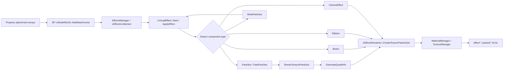

# OpenSCP Effect 解算与渲染复刻设计报告

日期：2026-10-26  
范围：Property Editor 中 SimCity 2013 `EA::Swarm` Effect 的按需精细预览  
状态：设计基线，已验证的资源链路与当前实现分开标注

## 1. 设计结论

Property Editor 的默认路径保持轻量：首次进入工作区只加载建筑、地面和普通 unit，Effect 单元显示黄色尖锥挂点。精细 Effect 渲染由用户手动开启；开关关闭时不请求 Swarm 集合、不解码纹理、不启动粒子时钟，也不创建 Effect GPU 对象。

开启后，系统按需解析当前包中被建筑引用的 Effect ID，建立可复现的 Swarm 解算状态，再把已解析组件交给对应 renderer。黄色尖锥只表示 attachment 调试层，精细预览成功后仍可单独开启它；解析失败时使用明确的未解析占位状态，避免把占位物误认为粒子最终位置。

一个 Effect attachment 可能包含普通粒子、MetaParticle、Beam、Ribbon、Volume、模型、声音或游戏逻辑组件。预览器必须保留组件类型和状态，不把所有组件压缩成一个“粒子”类型。

## 2. 已验证的游戏侧路径

建筑或 Lot Property 的 Effect 并不是一个图片资源。`0x00B1B104` Property 通过并行数组保存 attachment：

| 字段 | 哈希 | 语义 |
| --- | --- | --- |
| VisualEffect ID | `0x02A907B5` | Swarm 集合导出的效果名称哈希 |
| Transform | `0x02A907B6` | attachment 的局部变换 |
| World | `0x02A907B9` | Effect 所属 world |
| External ID | `0x02A907BB` | 运行时状态控制 ID |
| Enabled | `0x02A907BC` | 初始启用状态 |

`00B1B104:41E1C000:9949C550` 已在 `SimCityDataEP1.package` 中验证：它含 12 个 Effect attachment，多个 ID 共享相同 transform，`enabled` 全部为 false。这说明挂点数量、视觉效果数量和实际粒子 emitter 数量是三个不同概念。

运行时主链路为：



Swarm 组件枚举中，`1` 是普通 Particles，`2` 是 MetaParticles，`12` 是 FastParticles，`13` 是 Distribute，`14` 是 Ribbon，`16` 是 Beam；`3..11` 和 `32..63` 还可能是非屏幕视觉或外部组件。

## 3. OpenSCP 目标架构

### 3.1 资源层：EffectResolver

资源层只在精细开关打开后运行，输入是当前包、关联包和当前建筑使用的 visual effect name hashes。

```text
EffectAttachment
  ├─ attachmentIndex
  ├─ visualEffectId
  ├─ externalControlId
  ├─ localTransform
  ├─ initialEnabled
  └─ source = model | lot

SwarmVisualEffect
  ├─ blocks: VisualBlock[]
  ├─ transforms
  └─ component references

SwarmComponent
  ├─ ParticleComponent
  ├─ MetaParticleComponent
  ├─ FastParticleComponent
  ├─ BeamComponent
  ├─ RibbonComponent
  ├─ VolumeComponent
  ├─ ModelComponent
  └─ UnsupportedComponent
```

解析缓存的键应包含：包内容指纹、集合 TGI、visual effect ID、质量档和解析器版本。这样修改包或解析器时不会复用旧的二进制解释结果。

当前 `read_effect_preview` 已有请求上限 64 个 Effect、总 emitter 上限 128 个、嵌套 VisualEffect 最大深度 4；这些限制应保留为安全上限，并把实际裁剪数量返回给前端。

### 3.2 解算层：SwarmSimulator

解算器与 renderer 分离。它只生成时间相关的实例数据，不接触 Three.js。

每个 Effect 实例包含：

- `simulationTime`、`fixedStep`、`loop/retrigger` 状态；
- 确定性随机种子，种子由 `visualEffectId + attachmentIndex + emitterIndex` 生成；
- emitter 生命周期、出生队列和死亡队列；
- 局部 transform 与父级 MetaParticle transform；
- 当前状态集合，例如 `initial`、`fire`、`night`；
- `approximate` 和 `unsupported` 诊断信息。

建议固定步长为 30 Hz，渲染帧使用前后两个 simulation snapshot 插值。关闭精细开关后立即停止 simulation clock，清空 GPU 对象和纹理引用。

普通粒子第一阶段覆盖：lifetime、preroll、rate、方向、速度、体积、size/aspect/rotation/alpha/color 曲线、gravity、wind、drag、atlas frame 和 velocity stretch。

第二阶段补齐：rate delay/retrigger、variation、torus/ellipsoid 分布、wiggle、surface collision、random walk、attractor、path、death effect。

MetaParticle 必须拥有独立的子效果时间线。当前实现用父 emitter 代理子效果，只能标记为 approximate，不能作为最终所见即所得结果。

### 3.3 渲染层：五类 renderer

#### ParticleQuadRenderer

服务普通 Particles 和第一版 FastParticles。

- camera-facing billboard；支持 up/across 方向；
- 当前帧、下一帧和 `frameDelta` atlas 插值；
- 颜色、alpha、size、aspect、rotation 由实例属性驱动；
- additive、alpha blend、multiply 等材质模式独立选择；
- soft particle 使用场景深度做边缘 alpha 衰减；
- velocity stretch 根据速度和 `mVelocityStretch` 拉伸 quad。

#### BeamRenderer

服务水柱、喷射火焰和连续能量束。最小实现读取 `P0/P1`、`numSegments`、size curve、color/alpha curve、fade、texture scroll/repeat；后续加入 slope、strength、random offset 和旋转。

#### RibbonRenderer

服务烟带、拖尾和弯曲水雾。最小实现读取 lifetime、segment length、width/taper、alpha/color curve、UV repeat/slip、wind/gravity；通过历史点缓冲生成带状网格。

#### VolumeRenderer

服务体积火焰、紫色雾和大范围烟雾。根据视线方向生成有限数量纹理切片，使用深度排序和 alpha 累积。它必须和局部 attachment 分开标记，因为截图中的全局雾可能来自天气或后处理。

#### NonVisual/UnsupportedRenderer

声音、相机、Shake、Game、Model 和未知外部组件不创建假粒子。前端显示组件类型和解析状态，挂点调试层可单独显示。

## 4. 材质和 HLSL 对齐策略

游戏侧 `drawMode == 15` 时，`drawInfo.resourceID` 首先查 `GetEffectMaterial` 或 `MaterialManager`，随后从材质参数中读取纹理引用，再交给 `TextureManager`。因此 OpenSCP 不应把主 resource ID 直接当成图片 ID。

HLSL 复刻优先级：

| 游戏片段 | OpenSCP 实现 |
| --- | --- |
| `particleQuadVS` | ParticleQuadRenderer billboard |
| `particleQuadPS` | atlas 双帧采样和颜色乘法 |
| `effectSimpleMultiplyAndBlendPF` | 材质 blend/color multiply 参数 |
| `softParticles` | 深度纹理 alpha 衰减 |
| `fastParticleQuad*` | FastParticle 专用几何和材质分支 |
| `volumeFire` / VolumeEffect | VolumeRenderer 切片近似 |

第一版可以使用 Three.js 自定义 shader，但实例数据布局应保持接近游戏侧：position、color、size、aspect、rotation、frame、nextFrame、frameDelta、depthFade。这样后续替换成更接近 RenderWare 的批处理路径时无需改解算器。

## 5. 默认行为与交互设计

默认进入工作区时：

- `renderEffects = false`；
- 不调用 `read_effect_preview`；
- 不创建 Effect texture、material、solver 或 animation frame；
- 显示黄色 attachment 尖锥，作为调试挂点；
- 首屏延迟与当前普通模型预览保持一致。

用户手动打开精细 Effect 开关后：

1. 显示“正在解析 Effect”状态；
2. 后端异步扫描所需集合和材质；
3. 先显示已解析的 emitter，未完成部分保留明确的未解析占位；
4. 解析完成后启动固定步长模拟；
5. 关闭开关时停止时钟并释放本轮 Effect 资源。

开关、状态、组件类型、近似提示和调试挂点名称全部走 zh-CN/en-US i18n。用户无需阅读 Swarm 说明即可通过状态颜色和组件标签理解结果。

建议提供三个预览状态：

- `Initial`：按 Property 初始状态；
- `Fire/Active`：启用与火灾相关的 external ID；
- `All components`：强制显示已解析视觉组件，用于资产开发检查。

单一静态画面无法表达同一建筑的正常烟雾和火灾状态，因此状态选择器是所见即所得的必要组成部分。

## 6. 性能预算

关闭状态预算为零，黄色尖锥继续使用现有轻量路径。

开启状态使用以下初始预算：

| 项目 | 初始上限 |
| --- | ---: |
| 单次请求 Effect ID | 64 |
| 总 emitter | 128 |
| 单效果嵌套深度 | 4 |
| 单个 emitter 粒子 | 320 |
| 当前工作区 Effect 粒子总数 | 2400 |
| 解算频率 | 30 Hz |
| 每帧 GPU 上传 | 仅活动 emitter |

预算耗尽时按优先级裁剪：远距离 Effect → 非选中建筑 →低优先级 emitter →粒子数量。裁剪结果必须进入诊断，不得静默变成黄色尖锥。

纹理、材质、解析结果和 GPU buffer 均按 package/effect/quality 共享；关闭开关后延迟一帧释放，避免用户快速切换时重复创建。首次开启解析应放在异步任务中，界面保持可交互。

## 7. 实施阶段

### P0：语义和生命周期

- 保留默认黄色尖锥；
- 把尖锥标记为 attachment debug overlay；
- 精细开关关闭时完全跳过 Effect 请求和时钟；
- 返回 attachment index、component kinds、render status；
- 同 transform 的 attachment 在诊断中分组。

### P1：普通粒子保真度

- 修正材质型 `drawMode=15` 纹理链；
- 补 soft particle、velocity stretch、blend 参数；
- 固定步长和确定性种子；
- 使用火焰、烟雾截图完成第一轮对拍。

### P2：Beam/Ribbon

- Beam 端点和 segment；
- Ribbon 历史点和宽度曲线；
- 使用消防车水柱和蒸汽作为验收样本。

### P3：MetaParticle 和状态

- 子 VisualEffect 独立时间线；
- external ID 状态切换；
- Initial/Fire/All 状态选择；
- 火灾建筑多 attachment 对拍。

### P4：Volume 和高级行为

- VolumeEffect 切片；
- surface collision、random walk、attractor、path、death effect；
- 夜间工业紫雾与局部喷焰分离验证。

## 8. 验收标准

### 性能

- 首次打开 Property Editor 不触发 Effect collection 解析；
- 默认首屏不创建 Effect solver 或纹理；
- 手动开启后解析在后台进行，界面可操作；
- 关闭后停止粒子时钟，重复开关不会累积 GPU 对象。

### 语义

- 黄色尖锥只表示 attachment debug overlay；
- 普通粒子、Beam、Ribbon、Volume、非视觉组件可区分；
- 解析失败显示“未解析组件”，不冒充最终粒子；
- 同一位置的多个 Effect attachment 可展开查看。

### 画面对拍

- 建筑 `00B1B104:41E1C000:9949C550`：烟囱与窗户挂点位置；
- 工业火灾：火焰亮度、烟雾方向、atlas 动画、深度交界；
- 消防车：水柱长度、宽度、端点、蒸汽团；
- 夜间工业区：局部紫色喷焰与全局紫雾分别验证。

## 9. 证据文件

- `D:/ea-games/simcity_dev/new-cource/SimCity2013-source-tree/src/GB/cEffectsCollection/Load.c`
- `D:/ea-games/simcity_dev/new-cource/SimCity2013-source-tree/src/EA/Swarm/cVisualEffect/Start.c`
- `D:/ea-games/simcity_dev/new-cource/SimCity2013-source-tree/src/EA/Swarm/cVisualEffect/ApplyEffect.c`
- `D:/ea-games/simcity_dev/new-cource/SimCity2013-source-tree/src/EA/Swarm/ReadDescription__2.c`
- `D:/ea-games/simcity_dev/new-cource/SimCity2013-source-tree/src/EA/Swarm/ReadDescription__5.c`
- `D:/ea-games/simcity_dev/new-cource/SimCity2013-source-tree/src/EA/Swarm/ReadDescription__7.c`
- `D:/ea-games/simcity_dev/new-cource/SimCity2013-source-tree/src/SP/cEffectsRenderer/CreateTextureParticleSet.c`
- `D:/ea-games/simcity_dev/new-cource/SimCity2013-source-tree/src/EA/Swarm/GenerateQuadInfo.c`
- `D:/rust/packages/fluffy-open-scp/src-tauri/src/effect_service.rs`
- `D:/rust/packages/fluffy-open-scp/src/pages/packages/components/property-editor/effects/particleRenderer.ts`
- `D:/rust/packages/fluffy-open-scp/docs/re/effect-swarm-preview-analysis.md`
- `D:/rust/packages/fluffy-open-scp/docs/re/unit-props-effects-spawners-paths.md`

## 10. Prop、Effect、Light 的运行时可见性模型

### 10.1 静态资产和运行时状态必须分层

Property 只提供“有哪些挂点、资源和控制 ID”。真正的可见性由运行时状态计算。OpenSCP 应把输入分成四层：

```text
StaticAssetConfig
  ├─ PropBinConfig(resourceId, capacity, slots, usePercent, randomize)
  ├─ EffectAttachment(visualId, externalId, transform, initialActive, world)
  └─ LightBinding(lightId, transform, timeRules, flagRules, binRules)

SimulationState
  ├─ resourceBins[resourceIndex] = { amount, capacity }
  ├─ controlFlags = uint64
  ├─ period/timeOfDay
  ├─ triggerEvents / choreographySequences
  └─ manualOverrides

Rule/Event Controller → VisualBinding → Renderer
```

这样“车是否出现”“烟是否运行”“窗灯是否亮”都由可检查的输入决定，不能把 Property 中存在一行记录误当成当前帧必然可见。

### 10.2 Prop Bin：数量是模拟结果，不是槽位数量

`SC::cUnitBinDraw::Update` 使用 unit 的 `mResourceBins` 更新 `mResourceSlots`。当 `mUseBinPercent` 关闭时，槽位数量近似为 `mAmount`；开启时按 `ceil(amount / capacity × slotCount)` 计算。`mRandomizeSlot` 只改变槽位选择顺序，不能改变资源数量。资源 ID 还要经过脚本资源表解析成 graphics key，之后才会实例化车辆、垃圾桶或其他模型。

因此，停车场的十个车辆槽位只是上限。售出但未入住时，若对应资源 bin 的 amount 为零，十个槽位可以全部为空；入住、通勤或其他模拟规则改变资源量后，`cUnitBinDraw` 才会逐个添加/移除实例。仅凭“Property 中有十个 prop”无法判断当前是否应该出现十辆车。

OpenSCP 的 Prop 预览应同时显示：`slotCount`、`amount/capacity`、实际显示数量、resourceId→graphics key 的解析状态。没有模拟快照时使用“静态槽位”模式，并明确标记为 `simulation unavailable`，不要伪装成游戏当前状态。

### 10.3 Effect：三条开关路径

已验证的 Effect 开关来源有三种：

1. **控制位路径**：`SC::cUnitModel::UpdateModelEffects` 遍历 `mControlFXActiveInfo`，按 `unit->mControlFlags` 的某一位调用 `SetEffectsRunning(enable, softTransition=1, externalId)`。
2. **资源比例路径**：同一函数中的 `mAnimFXActiveInfo`、`mAnimFXFloatInfo`、`mAnimFXVector3Info` 读取 `mResourceBins[bin]` 的 `amount/capacity`，按阈值启停 Effect，或把比例插值后写入 Effect 参数。
3. **规则/编排序列路径**：`TurnRuleEventsOn/Off` 对 `TriggerInfo` 类型 4 直接调用 `SetEffectsRunning`；类型 1 启停 choreography sequence。`cChoreographyAnimations::Update` 在轨道时间点调用 `EffectControl`，序列结束或停用时停止当前 Effect。

`SP::cModelWorld::SetEffectsRunning` 再按 `mEffects[i].mID` 匹配 external ID，并执行 `CreateEffect/Start/Stop`。所以 `visualEffectId` 负责“加载哪一个 Swarm 集合”，`externalId` 负责“当前规则控制哪一个挂点”。

对用户给出的建筑 `00B1B104:41E1C000:9949C550`，12 个 attachment 的 `enabled` 全为 false 只能证明静态初始态；它不能证明烟或火焰永远关闭。要把“烟囱正常烟”和“窗户着火火焰”命名为具体状态，仍需解析该建筑所引用的脚本 rule/trigger 表，建立 `controlFlag bit / trigger event ID → externalId` 的映射。当前反编译证据已经证明了控制机制，但没有证明某个具体 external ID 就是火灾状态。

### 10.4 Light：至少存在三种不同语义

OpenSCP 不应把所有 Light 合并成一个布尔值：

| 类型 | 引擎路径 | 可见性/强度控制 |
| --- | --- | --- |
| ModelWorld 局部灯 | `cModelWorld::AddAttachments` 读取 `0x049FC837..83A` 强度、颜色、尺寸、偏移数组 | 创建时挂到模型；是否参与渲染还受模型 world/draw set 控制 |
| Graphics Light ID | `cGraphicsLights::FillFromProps/Update` | 时间段、unit control flag、unit resource bin 阈值；`SetVisible` 维护 On/Off/Turning 状态和过渡音效 |
| Swarm LightEffect | `cLightEffect::Start/ApplyEffect/Stop` | 曲线驱动颜色、强度(Kd/Ks)、半径和内半径；支持 cycles，非循环结束后硬停止 |

`cGraphicsLights::Update` 会先检查 `GetLightingTimeOverride` 或 `PeriodTime(periodId)`，再检查 unit flag map，最后检查 bin map 中的 `amount/capacity` 与阈值。也就是说窗灯可能同时受昼夜、入住/资源状态和过渡配置影响。`cLightEffect` 的曲线动画则是已启动灯的局部时间线，不能替代这些可见性条件。

## 11. OpenSCP 的状态场景设计

### 11.1 场景不是“猜测游戏”，而是可复现输入快照

Property Editor 提供一个轻量的 `PreviewScenario`：

| 场景 | 预置输入 | 主要验证目标 |
| --- | --- | --- |
| Initial | Property 初始 active、资源量为零或快照值 | 检查挂点、初始 enabled 和静态模型 |
| Occupied | 设置入住资源 bin 到用户指定比例 | 检查停车位车辆、垃圾桶和 bin 驱动灯 |
| RushHour | 在 Occupied 基础上切换通勤/交通相关 control flags | 检查车辆与编排序列触发的 Effect |
| FireRisk | 仅启用已解析的风险 flag/事件 | 检查规则绑定，不强制伪造火焰 |
| OnFire | 启用明确映射到 external ID 的火灾事件 | 检查窗户火焰、烟和相关灯光 |
| Night | 设置 period/timeOfDay，保留其他状态 | 检查时间段灯与 Swarm LightEffect 曲线 |

场景值必须可编辑，并在每个可见对象上显示原因：`visible because: bin 3 = 0.8`、`hidden because: control flag 12 = 0`、`started by: trigger event 0x...`。若没有规则映射，界面提供“手动启用此 external ID”，并标记为 `manual override`。

### 11.2 可见性解析优先级

```text
手动覆盖（作者明确选择）
  > 场景规则（已解析的 control flag / trigger / time / bin 条件）
  > Property 初始状态（enabled / 初始灯状态）
  > 未知（保持挂点或 unresolved 标记）
```

未知状态不得默认为“开”或“关”后静默渲染。Effect 解析失败保留黄色挂点并附上组件诊断；Prop 资源无法解析时保留槽位轮廓；Light 条件未知时显示灯的绑定信息但不改变场景中已有灯光。

### 11.3 默认性能策略

首次进入工作区继续使用 `renderEffects=false` 和黄色尖锥。Prop 的静态挂点、Light 的绑定轮廓和普通模型可立即显示；只有用户打开“精细运行时预览”后才创建 `SimulationState`、解析规则/集合、启动 30 Hz solver 和纹理/GPU 对象。场景切换只重算受影响的 bin、external ID 和 light 条件，避免整栋建筑重建。

所有开关、场景名、原因标签和诊断文本都必须提供 zh-CN/en-US i18n。建议的最小文案包括“精细运行时预览”“显示原因”“手动启用”“规则未解析”“模拟快照不可用”。

## 12. 证据边界与下一步

已证实：Prop 的显示数量来自资源 bin；Effect 可由控制位、资源比例、规则事件和 choreography 控制；Light 可由时间、控制位、资源阈值及曲线控制。尚未从当前证据确定：某个具体建筑 external ID 与“火灾风险/着火/正常烟”名称的最终对应关系，以及入住人数如何在脚本规则中转换为具体资源 bin 数值。

因此下一步不是给每个 attachment 写固定语义，而是实现脚本资源和 rule/trigger 解析器：

1. 解析 unit 的 script resource 表，完成 Prop resourceId→graphics key；
2. 解析 `cEcoUnitRule` 的 control flag mask/value、TriggerInfo 和 choreography track；
3. 对目标 TGI 生成 `externalId → [conditions, effects, lights, props]` 绑定图；
4. 用游戏截图中的 Initial/Occupied/OnFire/Night 四个场景逐项对拍。

在第 2 步完成前，OpenSCP 可以提供状态覆盖和原因诊断，但不应把“黄色尖锥位置”直接标成“粒子效果位置”，也不应把“有十个槽位”直接标成“有十辆车”。

新增取证文件：

- `D:/ea-games/simcity_dev/new-cource/SimCity2013-source-tree/src/SC/cUnitModel/UpdateModelEffects.c`
- `D:/ea-games/simcity_dev/new-cource/SimCity2013-source-tree/src/SC/cUnitModel/TurnRuleEventsOn.c`
- `D:/ea-games/simcity_dev/new-cource/SimCity2013-source-tree/src/SC/cUnitModel/TurnRuleEventsOff.c`
- `D:/ea-games/simcity_dev/new-cource/SimCity2013-source-tree/src/SC/cChoreographyAnimations/Update.c`
- `D:/ea-games/simcity_dev/new-cource/SimCity2013-source-tree/src/SC/cChoreographyAnimations/DeactivateAnimSequence.c`
- `D:/ea-games/simcity_dev/new-cource/SimCity2013-source-tree/src/SC/cGraphicsLights/Update.c`
- `D:/ea-games/simcity_dev/new-cource/SimCity2013-source-tree/src/SC/cGraphicsLights/SetVisible.c`
- `D:/ea-games/simcity_dev/new-cource/SimCity2013-source-tree/src/SC/cGraphicsLights/FillFromProps.c`
- `D:/ea-games/simcity_dev/new-cource/SimCity2013-source-tree/src/SP/cModelWorld/AddAttachments.c`
- `D:/ea-games/simcity_dev/new-cource/SimCity2013-source-tree/src/SP/cModelWorld/SetEffectsRunning.c`
- `D:/ea-games/simcity_dev/new-cource/SimCity2013-source-tree/src/SC/cLightEffect/Start.c`
- `D:/ea-games/simcity_dev/new-cource/SimCity2013-source-tree/src/SC/cLightEffect/ApplyEffect.c`
- `D:/ea-games/simcity_dev/new-cource/SimCity2013-source-tree/src/SC/cLightEffect/Stop.c`

