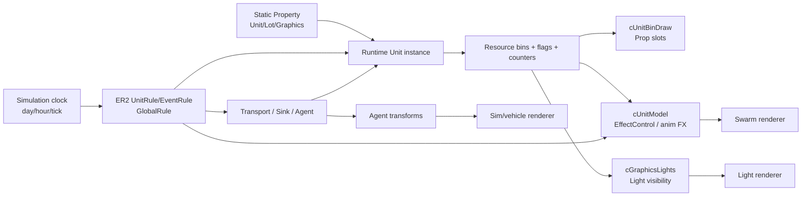

# 小学 Property → ER2 → 运行时状态 → 图形槽位模型

日期：2026-10-27  
研究基准：小学 `C264A268`，主体 Unit `40E0C000:C264A268`，Lot/Graphics `40E1C000:C264A268`。  
目标：解释 Property 为什么是静态拓扑，以及 ER2、资源 bin、Transport 和图形消费者如何随模拟时间产生临时可见状态。

## 1. 核心结论

Property 不会被游戏逐帧改写。它提供 Unit、bundle、资源容量/初值、位置锚点、路径、Prop 槽位、Effect attachment 和 Light 绑定。游戏加载 Property 后创建一个运行时 Unit 实例，ER2 规则和 Transport 系统不断修改这个实例的资源 bin、控制位、规则计数器和 Agent 容器；图形系统再把这些运行时值投影到 Prop、Effect、Light 和 Agent 上。



对 OpenSCP 而言，正确的编辑对象不是“修改 Property 直到画面看起来对”，而是：

```text
StaticAssetGraph + RuntimeSimulationState + VisualProjection
```

Property Editor 应生成一个可复现的运行时投影；关闭模拟时仍显示静态挂点，开启模拟后才显示由状态计算出的车辆、学生、灯光和 Effect。

## 2. 小学的静态依赖图

小学入口链已经闭合到以下层级：

```text
Menu2 29873FA2
  └─ menuUnit C264A268
      ├─ Unit 40E0C000:C264A268
      │   ├─ parent 48E0C000:7E4B99E5
      │   ├─ child 8C4245A6（校车停车位扩展）
      │   ├─ bundle 6C042367（教育主体）
      │   ├─ bundle 3A1C3971（教育附加规则组）
      │   ├─ bundle 95573B5D（资源/状态容器候选）
      │   └─ bundle 9A1BFB2F（空/占位容器）
      └─ Lot/Graphics 40E1C000:C264A268
          ├─ UnitLocation / Path
          ├─ Prop Bin
          ├─ Light
          └─ Effect attachments
```

`0x0A0209A5` 是 connected-unit/bundle 数组，不是 Rule ID；`0x0A0209B2` 是排除容器引用。`AddBundle` 再从 bundle 的 `0x08080D58 + 0..2` 和事件槽 `0x08327D48 + index` 解析 UnitRule/EventRule。也就是说，规则不是直接写在 Lot Property 的 Prop/Effect 行里，而是通过 Unit、父 Unit 和 bundle 间接挂入运行时。

### 2.1 小学静态字段的三种作用

| 静态字段类别 | 小学证据 | 运行时用途 |
| --- | --- | --- |
| 容量/阈值 | `Work_TotalJobs=25`、`JobsW1/W2/W3=20/5/0`、`Work_MinimumWorkersForProduction=5` | 规则专用化、容量检查、Worker 状态初始化 |
| 资源初值/生产参数 | `0x0C216562=10`（GarbageOnlyAmount）、Power/Water Needed 属性 | 规则的 input/output、simRate 专用化、垃圾生产候选 |
| 图形拓扑 | Prop slot、Effect attachment、Light table、UnitLocation、Path | 只描述“在哪里、挂什么、最多多少”；不决定当前是否可见 |

`JobsW1/W2/W3`、`WorkersNeeded`、`TotalWorkers`、`Student` 等运行时 bin 不能反向覆盖回主体 Property。扩建、connectedUnits 和财富等级会形成新的聚合状态；Property Editor 必须保留“基础值、继承值、扩建值、运行值”四个来源。

## 3. 以日志闭合的运行时规则

### 3.1 入学 sink：一个 Agent 到达可以改变多个 bin

教育 bundle `6C042367` 的 sink 表：

```text
0A2725CE → sink entry 78B96709
0A2725CF → rule B52C889D
```

`B52C889D` 的静态资源操作和运行日志已经闭合为一次入校接收事件：

```text
nearby KidE2              -1
local Student             +1
local TotalStudents       +1
local StudentStudyingE2   +1
local SpotsForKids        -1
global education stats    更新
FromTradingConnection     由 fromBinOps 替换数量
```

日志中同一模拟 tick 出现 18 或 21 次入校更新，证明一个 UnitLocation 或 spawner 点不是一个学生。真正的粒度是 Transport transaction/Agent；多个 Agent 到达同一个 sink 后，行人系统还可能进一步把他们组成动态 pedestrian group。

已观察到：

| 时间段 | Student | StudentStudyingE2 | SpotsForKids | 解释 |
| --- | ---: | ---: | ---: | --- |
| 上课时段开始 | 875 → 950 | 同步增加 | 75 → 0 | 多次入校 sink，占满 950 个席位 |
| 15:00 跨界 | 950 → 0 | 950 → 0 | 0 → 950 | 放学释放当前在校状态 |
| 次日早晨 | 0 → 1（窗口外首次捕获） | 同步 | 950 → 949 | 新一轮入校开始 |

样本中始终满足 `Student + SpotsForKids = 950`。这使 `Student`/`SpotsForKids` 成为最可靠的视觉状态输入：学校“有人”可以由 Student bin 判断；停车位车辆和学生 Agent 仍需各自的 Transport/Prop 绑定，不能用同一个数字替代。

### 3.2 每日统计重置：改变的是统计 bin，不是人物位置

`C193A5BB` 的触发配置是 day 周期的 0.25，即约 06:00。它通过 `fromBinOps` 读取 `TotalStudents` 并清零。日志观察到 05:59:56–06:01:12 期间：

```text
TotalStudents 950 → 0
ExamsPassedE2 950 → 0
Student        0（未观察到入校）
SpotsForKids   950
```

因此 `TotalStudents` 是日程/统计量，不是当前在校人数；清零不能驱逐 Agent，也不能触发建筑关闭。OpenSCP 若把 TotalStudents 直接画成人物数量，会制造错误的“清晨学生全部消失”画面。

### 3.3 整点教育规则：检查条件，不等于生成学生

`23E737BD` 是 hour 周期起点规则，`triggerPeriod=Hour`、`variance=0`。静态资源前缀包含未知内部资源 `C02F343B`、`SpotsForKids` 以及 global 动态输入 `0xBE2C0EB3`。日志中该规则在 11:00、16:00、17:00、18:00 等整点推进 `triggerCount`。

它应被建模为：

```text
到点 → 检查教育内部计数/剩余席位/全局条件
     → 可能附加成功或失败规则
     → 可能影响后续 Agent/资源事件
```

不能把每一次 `23E737BD` 应用直接解释为“一节课”或“生成一群学生”。

`40313FC2/C1/C4/CB`、`413141B7/B0/BD`、`3E313CFD` 是按 day 的 0、0.125 … 0.875 排布的时间检查规则，处理 `StudentsNeeded_00/03/06/09/12/15/18/21`、`ExamsPassedE2` 及成功/失败链。它们构成学校日程检查网络，但由于发行版没有恢复原始 ER2 文本，规则名称只能保留为 ID 和已验证资源符号。

### 3.4 水电：Property 专用化改变调度频率

小学父级 `48E0C000:2A25CF66` 的两条规则：

| Rule | 基础 simRate | Property 专用化 | 日志 |
| --- | ---: | ---: | --- |
| `D51CB94C` Power | 30 | `0x0AFB9882=72` | 每约 72 tick 检查，库存 270 → 180，随后恢复 |
| `D54F8B18` Water | 72 | `0x0C09DA6A=72` | 每约 72 tick 检查，库存 270 → 180，随后恢复 |

一次输入为 90，等于对应 `PowerNeeded/WaterNeeded`。因此 `simRate=72` 是检查间隔，不是“一定每 72 分钟成功消费一次”；控制状态、资源条件和成功/失败链仍会决定是否执行。

放学后 Student=0，但水电规则仍然运行，说明“没有学生”不等于“设施停止模拟”。这也是图形上不能把所有灯、Prop 和 Effect 绑定到一个 `occupied` 布尔值的直接证据。

### 3.5 垃圾：静态生产量、运行 bin 和显示 Prop 是三层

小学主体有 `0x0C216562=10`，符号为 `kPropGarbageProducer_GarbageOnlyAmount`。静态规则候选 `02FF875F` 的资源前缀为：

```text
local Garbage       input 1 → 0
map   0xF69DF1C6    input 0 → 100
global GarbageLost   input 0 → 1
```

日志在约 06:00 观察到：

```text
Garbage             0 → 100
GarbageDisplayCount 0 → 1
约 06:11            三者同时回到 0
```

这里至少有三个不同对象：

1. `GarbageOnlyAmount=10`：静态生产参数；
2. `Garbage=100`：运行时资源 bin 的瞬时存量；
3. `GarbageDisplayCount=1`：用于图形/显示或规则的计数 bin，可能触发垃圾桶 Prop。

因此垃圾桶 Prop 应绑定 `GarbageDisplayCount` 或对应 Prop Bin 的资源索引，而不能直接绑定静态值 10。清运后 bin 回零，`cUnitBinDraw` 才会移除由资源数量驱动的垃圾模型。静态 `Prop` 行只提供垃圾桶位置和模型槽位。

生产规则的每日入口、清运 Transport 和 `GarbageLost` 的完整因果链仍未全部闭合；OpenSCP 应显示“已观察到的 bin 变化”和“候选规则”，而不是声称已经恢复清运车路线。

### 3.6 Worker：岗位、最低阈值和当前人物不是同一字段

小学静态值：

```text
Work_TotalJobs = 25
JobsW1/W2/W3   = 20/5/0
MinimumWorkers = 5
```

运行快照中：

```text
WorkerW1=5, WorkerW2=0, WorkerW3=0
WorkersNeeded=5/5
ExtraWorkerW1: 0 → 1 → 0
ExtraWorkerW1Paused: 0 → 1 → 0
TotalWorkers: 5 → 6 → 5
```

136 个样本符合：

```text
TotalWorkers = WorkerW1 + WorkerW2 + WorkerW3
             + ExtraWorkerW1 + ExtraWorkerW1Paused
```

这只是本次小学快照的观测关系。它说明 `Paused` 是运行时状态的一部分，也说明 `TotalWorkers=5` 不能直接渲染成五个固定站在建筑里的小人。规则 `938552F2`、`6C855B1F`、`D2460875`、`B667C3C7` 与这些变化形态相符，但目前属于静态候选，尚未全部得到函数级运行命中证据。

`F1FD62EF` 及 `406CCC43` BuildingType 规则会读取 `WorkersNeeded` 剩余容量，并写入 `TotalWorkers/WorkersNeeded/ActiveBuilding`。因此建筑是否 active 还可能由最低劳工阈值和初始化规则控制，不能用 `WorkerW1` 单字段决定模型、灯或 Effect。

## 4. 从规则状态到图形槽位

### 4.1 每个 tick 的推荐执行顺序

OpenSCP 的离线模拟器应保存同一 tick 内的事件顺序，不能把所有变化合并成一个最终快照：

```text
1. 推进模拟时钟：simTick、day/hour period、phase
2. 取出到期的 UnitRule / GlobalRule / EventRule
3. 处理 Transport sink 到达和 transaction 完成
4. 检查 AgentTests、controlFlags、chance、容量和失败链
5. 应用 local / nearby / map / global resource ops
6. 应用 fromBinOps 和 Property 专用化后的动态数量
7. 更新 rule counter、nextTriggerTime、success/fail attach
8. 由图形消费者读取新的运行时状态：
   - Prop Bin：amount/capacity → slot visibility
   - Effect：controlFlags/bin ratio/event → externalId running
   - Light：time/flags/bin threshold → on/off/transition
   - Agent：transform/path/group → Sim/vehicle instance
```

规则的 `input=output` 操作是检查/门槛，不应计为净消耗；`input/output` 还必须乘以 `applyCount` 才能和快照差值比较。`999999` 是经常被 `fromBinOps` 替换的动态占位值，不应直接显示为真实产量或消费量。

### 4.2 Prop Bin 的投影

```text
runtime resource bin
  ├─ resourceIndex → script resource → graphics key
  ├─ amount/capacity
  └─ PropBinConfig(slotCount, usePercent, randomize)
       ↓
visibleSlotCount =
  usePercent ? ceil(amount / capacity * slotCount) : clamp(amount, 0, slotCount)
```

车辆、垃圾桶、煤堆等属于同一机制的不同资源语义。小学的校车停车位还要区分：Lot 中静态车棚/车辆模型、扩展 Unit 的容量统计、Transport 运行时的校车 Agent。这三者不能用 Property 中的一个 Prop 数组替代。

### 4.3 Effect 的投影

```text
controlFlags bit ───────────┐
resource bin ratio ─────────┼─> externalId state
TriggerInfo type 4 ─────────┤       ├─ Start/Stop Swarm effect
Choreography track ─────────┘       └─ LightEffect / child components
```

Effect attachment 的 `visualEffectId` 只决定要加载哪一个 Swarm 集合；`externalId` 才是规则控制键。对小学或普通建筑，只有把 ER2/事件表中的 ID 解析到 externalId，才能把“正常烟”“火灾烟”“窗户火焰”显示成有语义的状态。没有映射时，OpenSCP 应保留黄色挂点并显示 `unresolved external control`。

### 4.4 Light 的投影

动态 Light 至少要同时计算：

```text
visible = propertyInitial
       ∧ timeWindow(periodTime)
       ∧ unitFlagCondition(controlFlags)
       ∧ unitBinCondition(amount/capacity)
```

可见后再由 `cLightEffect` 曲线更新颜色、强度、半径和 cycles。夜间窗口、Worker/ActiveBuilding 状态和资源阈值可以同时作用；不应以 `Night` 或 `Occupied` 单字段代替所有条件。

### 4.5 UnitLocation / Path / Agent 的投影

小学的 `0x0E1BAC61/0x0E1BAC62` 是 UnitLocation ID + transform。它不是人数表。ER2/Transport 规则创建 transaction，Transport handler 再创建 Agent；多个 Agent 可以在同一个 UnitLocation 汇聚，并在运行时形成 pedestrian group。Path 的 pair、point、tangent、entry、scope 和 roadConnect 决定移动几何与入口语义。

所以 OpenSCP 应显示：

```text
UnitLocation = 位置锚点
Transport/Sink = 生成或接收条件
Agent = 当前运行实体
PedestrianGroup = 运行时组合结果
```

这解释了为什么“小学一个 spawner 点”不能直接渲染成一个人或一群人；预览中的示意小人必须标记为 sample，只有接入运行时 Agent 快照后才可以称为 observed agent。

## 5. OpenSCP 的实现模型

### 5.1 三个状态对象

```ts
type StaticSchoolGraph = {
  unitEntry: TGI;
  parentUnits: TGI[];
  bundles: BundleGraph[];
  unitLocations: UnitLocation[];
  paths: UnitPath[];
  propBins: PropBinConfig[];
  effects: EffectAttachment[];
  lights: LightBinding[];
};

type RuntimeUnitState = {
  simTick: number;
  periodTime: Record<PeriodId, number>;
  resourceBins: ResourceBinState[];
  controlFlags: bigint;
  ruleStates: RuleState[];
  sinks: SinkState[];
  agents: AgentState[];
};

type VisualProjection = {
  props: PropInstance[];
  effects: EffectInstance[];
  lights: LightInstance[];
  agents: AgentInstance[];
  reasons: VisibilityReason[];
};
```

`RuntimeUnitState` 是内存中的虚拟实例，不写回 Property。每次重播从相同 Property、ER2 AEB、初始 bin 和随机种子开始，就应产生同样的槽位变化。

### 5.2 场景输入应直接对应证据

建议首先支持以下小学场景：

| 场景 | 输入覆盖 | 可验证画面 |
| --- | --- | --- |
| `05:00` | Student=0、Spots=950、TotalStudents=上一日值 | 空校园、统计未重置前 |
| `06:00` | 执行 C193A5BB、垃圾/水电候选周期 | 统计清零、垃圾短时出现、灯光不强制关闭 |
| `09:00` | 批量执行 B52C889D sink | 学生/学习状态增加、席位减少、Agent 到达 |
| `15:00` | 执行放学状态转换 | Student/Studying 清零、席位恢复、建筑仍可消费水电 |
| `16:00+` | Worker Extra/Paused 候选状态 | 工人状态诊断、不要固定生成站岗小人 |
| `OnFire` | 仅启用已解析的 externalId/事件 | 窗口火焰、烟、LightEffect；未知映射保持挂点 |

场景面板必须显示每个变化的证据链，例如：

```text
Student +1
  ← UnitRule B52C889D
  ← sink 78B96709
  ← Transport transaction arrival
  ← source Agent = observed / synthetic
```

### 5.3 结果可信度分级

| 等级 | 允许的 UI 语义 |
| --- | --- |
| `observed` | 运行日志和静态规则在同一 Unit/tick 对拍 |
| `reconstructed` | 静态规则 + fromBinOps + 资源快照可复算，但没有完整函数级因果 |
| `candidate` | 静态候选规则与形态相符，尚未命中运行日志 |
| `synthetic` | 编辑器为了所见即所得提供的手动场景或示意 Agent |
| `unresolved` | 资源/规则/外部 ID 尚未解析，不得冒充游戏语义 |

小学报告中的 `B52C889D` 入校资源链、水电 72 tick 周期、Student/Spots 关系属于 `observed` 或 `reconstructed`；Worker Extra、垃圾清运链、学校校车具体 Transport 仍有 `candidate`/`unresolved` 部分。

## 6. 对之前 Effect/Prop/Light 设计的修正

此前的 `Initial / Occupied / RushHour / FireRisk / OnFire / Night` 场景仍然适用，但“Occupied”不能只设置一个布尔值。它至少要展开为：

```text
occupancyInputs:
  Student, WorkerW1/W2/W3, ExtraWorker, Paused
capacityInputs:
  SpotsForKids, WorkersNeeded, JobsW1/W2/W3
scheduleInputs:
  simTick, day/hour period, trigger counters
transportInputs:
  sink arrivals, transaction queue, Agent transforms
```

同样，“FireRisk”只能在发现实际 flag/event → externalId 绑定后才自动启用；否则应提供手动 external ID 覆盖并标记 `manual override`。这使作者看到的是“规则驱动的结果”或“明确的手动场景”，而不是一个看似真实、实际由猜测生成的粒子画面。

## 7. 当前证据边界

已闭合：

- 小学 Unit → parent → bundle → UnitRule/EventRule 的静态依赖图；
- `B52C889D` sink 对 Student/TotalStudents/StudentStudyingE2/SpotsForKids 的资源变化；
- `C193A5BB` 的每日 TotalStudents 重置；
- `23E737BD` 的整点检查入口；
- Power/Water 规则的 Property 专用化为 72 tick 以及运行时 270→180→270 变化；
- Student + SpotsForKids = 950 的容量关系；
- spawner 实为 UnitLocation，Agent 由 Transport transaction 创建；
- Prop/Effect/Light 消费者读取的是运行时 bin/flag/事件，而不是直接修改 Property。

仍未闭合：

- 学校校车具体 TransportEntry、path entry、UnitLocation ID 的一一对应；
- `C02F343B`、`0x219D6623` 等内部教育资源的正式名称；
- 垃圾产生规则到清运车 Agent 的完整链；
- Worker Extra/Paused 候选规则的函数级运行命中；
- 小学具体 Effect externalId 与火灾、夜间、设施状态的绑定；
- 发行版原始 ER2 ArgScript 文本。

因此，OpenSCP 第一阶段可以真实复刻“资源 bin 和规则时序导致的槽位变化”，但对尚未闭合的 Agent/Effect 语义必须显示证据等级和手动覆盖，不能静默推断。

## 8. 证据文件

- `D:/rust/packages/fluffy-open-scp/docs/re/elementary-school-mechanism-20261022.md`
- `D:/rust/packages/fluffy-open-scp/docs/re/elementary-school-rule-schedule-20261023.md`
- `D:/rust/packages/fluffy-open-scp/docs/re/school-runtime-synthesis-20261023.md`
- `D:/rust/packages/fluffy-open-scp/docs/re/er2-static-three-unit-analysis-20261023.md`
- `D:/rust/packages/fluffy-open-scp/docs/re/spawner-path-agent-er2-analysis-20261024.md`
- `D:/rust/packages/fluffy-open-scp/docs/re/elementary-school-9am-live-20261023.md`
- `D:/rust/packages/fluffy-open-scp/docs/re/elementary-school-3pm-6pm-watch-20261023.md`
- `D:/rust/packages/fluffy-open-scp/docs/re/elementary-school-5am-7am-final-watch-20261023.md`
- `D:/rust/packages/fluffy-open-scp/docs/re/evidence/elementary-school-rule-schedule-20261023.json`
- `D:/rust/packages/fluffy-open-scp/docs/re/evidence/elementary-resource-symbols-20261023.json`
- `D:/rust/packages/fluffy-open-scp/docs/re/evidence/elementary-school-dawn-offline-correlation-20261023.json`
